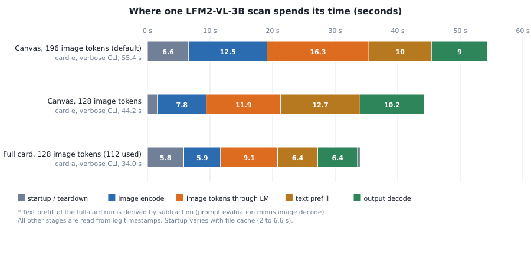
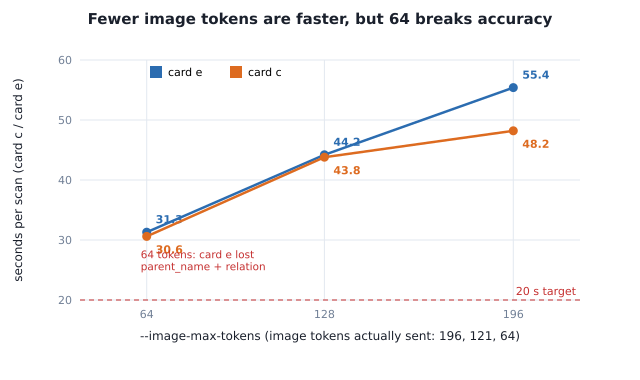
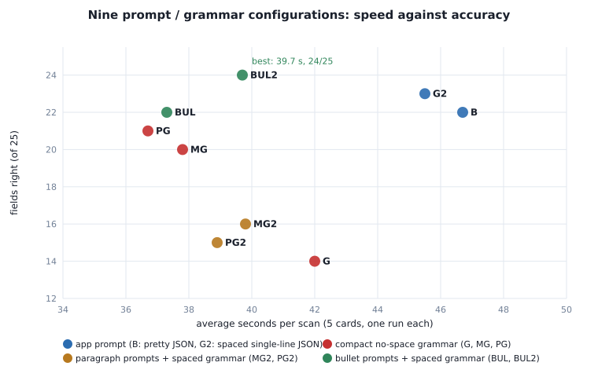
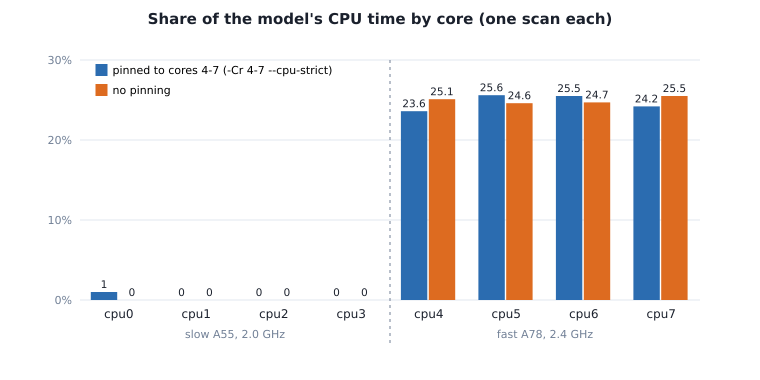
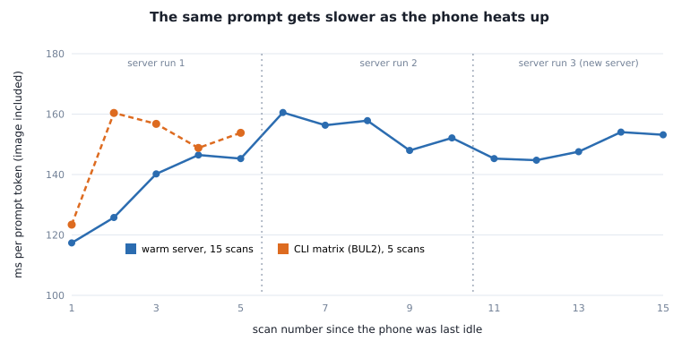
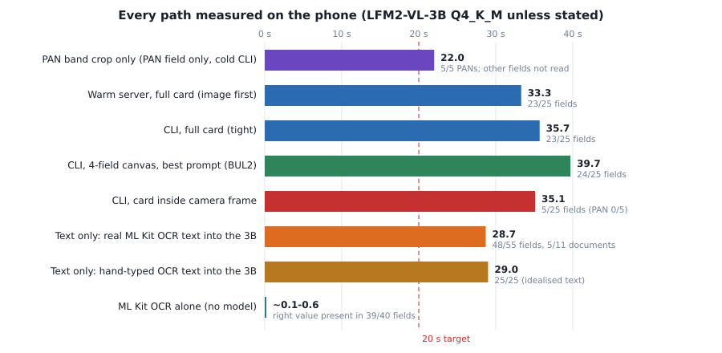

# LFM2-VL-3B on-device latency — findings, everything tried, and where it stands (2026-09-30)

Follows the structure of `MINICPM_LATENCY_FINDINGS.md`, but covers **one model only: LFM2-VL-3B** (language model `LFM2-VL-3B-Q4_K_M.gguf` + projector `mmproj-LFM2-VL-3B-Q8_0.gguf`). Device: Samsung SM-M356B (Exynos 1380, CPU only, 4 threads). Doc type: `pan_full`. Branches: `3B-LFM2` (AI-only work) and `2b-withOCR` (the OCR experiment; "2b" is a typo for 3B). Raw per-run data is in `lfm2_test_results/`; charts are in `docs/lfm2_figures/`.

**Status in one line:** on this phone LFM2-VL-3B reads a PAN card in **about 33–40 s at 23–24 of 25 fields correct**; every lever we could test moved that by 2–9 s at most; **under 20 s (and under 15 s) is not reachable with the model reading an image**; the only sub-25 s result is a crop of the PAN number alone (about 21–23 s cold, PAN field only, 5/5), and nothing here is built into the app yet.

**Reading conventions.** *Measured* = timed or counted on the phone in this work. *Derived* = arithmetic on measured numbers (the arithmetic is shown). *Estimated* = my reasoning, not run. *Inference* = an explanation that fits the evidence but was not isolated. Every table says which one it is.

**Data handling.** This document contains **no card numbers, names, dates of birth or father's names**. Cards are labelled a–e, and errors are described by field ("DOB day digit off by one") and never quoted. The ground truth used for scoring was read by eye from the card images by the assistant (there is no verified answer key), and lives only in `canvas_test_results/runs.csv`, which already contains real data and should be handled accordingly.

**Contents**

1. Summary
2. Goal, targets and constraints
3. Device, software and method
4. The model
5. How LFM2-VL handles an image
6. Where the time goes
7. Image-token sweep
8. Prompt and grammar matrix (nine configurations)
9. What the model is given: field canvas, full card, camera frame
10. Warm server
11. Prompt-prefix caching
12. Shorter output formats
13. CPU cores and threads
14. Thermal drift
15. The OCR-first branch (`2b-withOCR`)
16. Ledger of every lever
17. What can still be gained (estimates)
18. Verdict and risks
19. Reproduction guide
20. Environment and files
21. Corrections to things I said earlier
- Appendix A: every matrix run
- Appendix B: prompts and grammars, verbatim
- Appendix C: test register
- Appendix D: glossary and arithmetic

---

## 1. Summary

### 1.1 The numbers that matter (LFM2-VL-3B Q4_K_M, all measured)

| Path | Avg latency | Accuracy (5 cards) | Notes |
|---|---|---|---|
| 4-field canvas, best prompt (BUL2), 128 image tokens, cold CLI | **39.7 s** (34.6–41.8) | **24/25 fields**, 4/5 documents | Best accuracy of the image paths |
| Full card front, same prompt, 128 tokens, cold CLI | **35.7 s** (33.1–39.8) | 23/25 fields, 3/5 documents, **PAN 5/5** | No cropping or stitching of the input |
| Full card front, warm `llama-server` | **33.3 s** (29.2–36.5) | 23/25 fields, 3/5 documents | Same outputs as the CLI; about 2 s faster |
| Card inside a camera frame (433×560), cold CLI | 35.1 s | **5/25** fields, PAN 0/5 | The model invents values; card must be found and cropped first |
| PAN-number band crop only, cold CLI | 20.9–23.1 s | PAN 5/5 (other fields not read) | Fastest image path, but reads one field |
| Text only: real ML Kit OCR text into the 3B | 28.7 s (25.8–41.5) | 48/55 fields, 5/11 documents | The model damages correct OCR values |
| ML Kit OCR alone, no model | 0.05–0.24 s (0.58 s first call) | right value present in 39/40 fields | Not yet turned into fields (no parser written) |

### 1.2 What we established

1. **Image tokens set the price.** Encode plus pushing image tokens through the language model costs about **0.15 s per image token** (derived, section 5). 196 → 128 → 64 tokens gave 55 → 44 → 31 s. At 64 tokens the model lost fields, so **128 is the setting**.
2. **The output grammar matters more than it looks.** A compact JSON grammar with no space after `:` made the model answer `null` for the PAN number on most cards (14/25 fields). The same grammar **with normal spacing** restored it (23/25). The model wants to write `"key": "value"`.
3. **Prompt layout matters more than prompt length.** Paragraph prompts were 6–8 s faster but lost `parent_name` and `parent_relation`. A **bullet** layout of the same length kept them. Removing "Use null if unreadable" stopped the model from nulling out whole groups of fields (best config, BUL2: 39.7 s, 24/25).
4. **The input picture matters as much as the prompt.** A full card front reads as accurately as the stitched field canvas (23/25 vs 24/25, and all five PANs right) at the same token budget and the same latency. A card lying inside a camera frame does not work at 128 tokens (5/25).
5. **A warm server saves about 2 s, not 6.** Startup is 2–6 s and depends on file cache; the model itself is not the cost.
6. **Prompt caching does not work for this model with images on this server build.** It reused 1 token of about 190. Putting the instructions before the image also cost accuracy.
7. **Shorter answers are faster but not usable.** One-letter JSON keys or unlabeled lines saved 1.5–3.5 s of decode and made the model put the header text in the name field. Rejected.
8. **Cores are not the lever.** All four model threads already run on the fast cores (99–100% of CPU time), with or without pinning; the pinning flags change nothing here.
9. **The phone slows down as it works.** The same 190-token prompt went from 117 to about 150 ms per token over 5–10 consecutive scans. Sustained latency is roughly **25% worse** than a cool single scan.
10. **Putting the 3B after an OCR step made results worse.** The model changed correct OCR values (a PAN was rewritten) and mixed up fields. It also cannot repair a misread PAN from text (2/5 with the best prompt) and **invents a PAN when none is present (0/5 correct)**.

### 1.3 What the evidence does and does not support

| Claim | Supported? |
|---|---|
| The image path can go under 20 s | **No.** Best 33.3 s warm; estimated floor with every untested lever is about 25 s (section 17) |
| Accuracy of 23–24/25 fields on the five cards | Yes, but the sample is five cards and the answer key was read by eye |
| The result generalises to real photos | **Not shown.** No live camera photo has been tested; the frame test failed |
| OCR + rules would be fast and accurate | Plausible (OCR found the right value 39/40 times, in 0.05–0.24 s) but **the parser was never written**, so untested |
| The 3B is a good fallback reader | Only as an image reader of a small crop (PAN band 5/5). As a text repair tool it is not reliable |

---

## 2. Goal, targets and constraints

**Task.** Extract PAN-card front fields (`pan_number`, `name`, `parent_name`, `parent_relation`, `dob`) on a mid-range Android phone, on the CPU, offline, with a llama.cpp-based vision-language model.

**Targets set by the user.** Latency **under 20 s, better under 15 s**, per scan. The team lead's rule: *a bigger model should give faster answers* ("if it is a big model, we have to get answers faster").

**Constraints.**
- CPU only (the llama.cpp build on the phone has no GPU backend).
- Language model quantised to **Q4_K_M**, projector **Q8_0**. Q4_0 was considered and left untested by decision (section 4.4).
- **Only LFM2-VL-3B** on these branches. Other models are out of scope here.
- **Accuracy must not go down** when latency is reduced: the acceptance gate used from section 9 onward is *at least 23/25 fields and 5/5 PANs on the same five full-card images*.
- The app must stay usable: nothing in this document has been built into the app yet.

**How the requirement evolved (why the sections are in this order).**

| Step | What was asked | Where it is covered |
|---|---|---|
| 1 | Pick a 3B-class model, Q4_K_M language model + Q8_0 projector | Section 4 |
| 2 | Download it, test it, reach under 20 s / 15 s | Sections 5–8 |
| 3 | Reduce image tokens; stay on Q4_K_M | Section 7 |
| 4 | Explain why a big model is not automatically fast (for the team lead) | Sections 6, 17 |
| 5 | "Speculative decoding is outside the box" — other ways to cut latency | Section 16 |
| 6 | Try an OCR layer in front of the AI, on a separate branch | Section 15 |
| 7 | "Help me find the PAN the OCR missed" prompt | Section 15.5 |
| 8 | Back to AI only; baseline on **full card images** | Section 9 |
| 9 | Warm server, prefix cache, shorter output, cores and threads | Sections 10–14 |

---

## 3. Device, software and method

### 3.1 Phone

| Item | Value |
|---|---|
| Model | Samsung Galaxy M35, SM-M356B, serial `RZCXA1SXH5V` |
| SoC | Exynos 1380 |
| Cores | 8. `cpu0–3`: Cortex-A55 (part `0xd05`), max 2.002 GHz. `cpu4–7`: Cortex-A78 (part `0xd41`), max 2.400 GHz |
| RAM | 5.4 GB total; about 2.3 GB available when the model files were copied |
| Storage | about 28 GB free |
| GPU | not usable: the llama.cpp build prints "no usable GPU found" and runs on CPU |
| Threads used | 4, intended for the four fast cores |

### 3.2 Software

- **llama.cpp fork:** `home/aiteam/model_testing/qvac-visionpsy-nano/llama-cpp-inference/llama.cpp-custom` (contains the `lfm2` architecture and the `LFM2` projector type in `tools/mtmd/`).
- **Binaries on the phone** (arm64, taken from the app's `lib/arm64`): `libllama-mtmd-cli.so` in `/data/local/tmp/mini/` and `llama-server` in `/data/local/tmp/server_test/`, each with its `.so` companions.
- **Models** in `/sdcard/Android/data/com.modeltesting.vlmtester/files/models/`.
- **Harness** in `/data/local/tmp/mini/mt/` (scripts, prompts, grammars, images, logs).
- **Laptop:** JDK 17 (`~/toolchain/jdk-17.0.20.1+1`), Android SDK 35, Gradle 8.7, `adb` from `/usr/bin/adb`. Everything is user-space; no sudo.

### 3.3 The exact command (harness `run_lfmx.sh`)

```
LD_LIBRARY_PATH=/data/local/tmp/mini /data/local/tmp/mini/libllama-mtmd-cli.so \
  -m .../LFM2-VL-3B-Q4_K_M.gguf --mmproj .../mmproj-LFM2-VL-3B-Q8_0.gguf \
  --grammar-file pan_json.gbnf --image <card.jpg> -p "$(cat bul2.txt)" \
  -n 512 --temp 0 --repeat-penalty 1.1 -t 4 -tb 4 \
  -Cr 4-7 -Crb 4-7 --cpu-strict 1 --cpu-strict-batch 1 -fa on \
  -ngl 0 --no-mmproj-offload --no-op-offload \
  --no-warmup -c 4096 --image-max-tokens 128 -v
```

| Flag | Why |
|---|---|
| `--temp 0`, `--repeat-penalty 1.1` | Greedy decoding: repeated runs give the same text, so one run per cell is enough |
| `-t 4 -tb 4`, `-Cr 4-7 -Crb 4-7 --cpu-strict 1 ...` | Four threads for generation and for prompt processing, meant to be pinned to cores 4–7 (section 13 shows the pinning has no effect in this CLI) |
| `-fa on` | Flash attention |
| `-ngl 0 --no-mmproj-offload --no-op-offload` | CPU only |
| `--no-warmup` | Skip the warm-up decode; the app does the same |
| `-c 4096` | The GGUF's default context is 128,000 tokens; without a cap llama.cpp reserves a large KV cache. Real prompts are 190–260 tokens |
| `--image-max-tokens 128` | Caps the image at 128 tokens (section 5) |
| `-n 512` | Output ceiling; the grammar ends output at the closing brace (about 55 tokens) |
| `-v` | Verbose log with stage timestamps |

The app's own invocation (`MainActivity.runOnePass()`) was replicated by `run_lfm.sh` for the very first runs. It passes `-jf pan_full.json` (a JSON schema) instead of a hand-written grammar and does not pass a system prompt for `pan_full`. `run_lfm.sh` also passes `-sys system.txt`, which llama.cpp takes as the literal text "system.txt" and not as a file, and `run_lfmx.sh` (every matrix run in this document) passes no system prompt at all. **The system prompt is therefore not a lever** (section 21).

### 3.4 Inputs

All five cards are printed PAN fronts. Labels a–e are stable across every table.

| Input set | What it is | Files | Sizes |
|---|---|---|---|
| **Field canvas** | Four regions cut from the card by fixed fractions (PAN number, name, father's name, DOB) and stacked onto one 448×448 image (layout defined in `canvas_test_results/README.md`) | `w_a … w_e.jpg` | 448×448 |
| **Tight full card** | The whole card front, as photographed or screenshotted, at native resolution | `tight_a … tight_e.jpg` | a 860×538, b 860×524, c 860×553, d 600×315, e 848×512 |
| **Camera frame** | The same card placed at about 65% of a 1080×1397 frame, then shrunk to 433×560 the way the app shrinks a photo (synthetic: built from the tight crops) | `frame_*.jpg` → `fr560_*.jpg` | 433×560 |
| **PAN band crop** | Only the region around the PAN number | `pan_crop_a … e.jpg` | 447×119 |
| **Real two-sided photo** | Front and back of card e in one screenshot | `real_bothsides_e.jpg` | 848×1058 (used in the OCR tests only) |

### 3.5 Ground truth and scoring

- **Ground truth** = the assistant read each card image and typed the five values. It is not verified against the physical cards.
- A field is **right** when the output equals the ground truth, compared case-insensitively unless a table says "strict". A field that is `null` when the card has a value is **wrong**.
- A **document** is fully right when all five fields are right.
- Repeats are not run: decoding is greedy, so the same input gives the same output. The CLI and the warm server (different processes, same flags) produced identical text on all five full-card images, which is the check we have. More *cards* would add information; more repeats would not.

### 3.6 Timing methods (read before comparing numbers)

| Number | Where it comes from | What it includes |
|---|---|---|
| **Wall** (`WALL=`) | `date +%s.%N` before and after, subtracted with `awk` | Model load, image, prompt, output, teardown. **Cold**: the CLI loads the model on every run |
| **llama.cpp "total time"** | End-of-run performance print | Within about 1 s of wall on the runs where both were recorded |
| **Server timings** | `timings` object of a `llama-server` reply, plus the client's own stopwatch | **Warm**: no model load; the request wall includes uploading the image |
| **Stage times** | `-v` log timestamps (`encoding image slice…`, `image slice encoded in N ms`, `image decoded in N ms`) | Encode and image-into-LM are exact; text prefill is derived by subtraction |

Two gotchas that shaped the method:
- **Android's `mksh` does 32-bit arithmetic.** Timing with `$(( ))` on nanosecond timestamps overflows silently and reports about 2 s for a 50 s run. Every timer here uses `awk`.
- **Runs are not independent** because the phone heats up (section 14). Where two configurations are compared, they were run interleaved and in rotated order (thread test, format test), or the comparison is flagged as confounded.

### 3.7 Limits of everything below

Five cards, one run each, ground truth by eye, no live camera photos, one phone, one session. A one-field difference (4% of 25) is inside the noise. The sections say so where it matters.

---

## 4. The model

### 4.1 How it was chosen

The brief was a 3B-class model with a **Q4_K_M language model and a Q8_0 projector in the same repository**, from the publisher or a trusted uploader, whose projector type the fork can load. Candidates checked on Hugging Face (file lists and sizes read, none run at that point):

| Model | Publisher | Q4_K_M + Q8_0 projector | Total | Fork support |
|---|---|---|---|---|
| Qwen2.5-VL-3B-Instruct | `ggml-org` | 1,930 + 845 MB | 2.78 GB | yes |
| Qwen3-VL-4B-Instruct (4B) | `Qwen` | 2,497 + 454 MB | 2.95 GB | yes |
| **LFM2-VL-3B** | **`LiquidAI` (official)** | **1,564 + 587 MB** | **2.15 GB** | **yes** |
| Nanonets-OCR2-3B | `mradermacher` (third party) | 1,930 + 848 MB | 2.78 GB | yes |
| InternVL3-2B (below the tier) | `ggml-org` | 1,117 + 337 MB | 1.45 GB | yes |

Excluded: Gemma-3-4B (no Q8_0 projector, only F16/BF16), dots.ocr (Q8_0 only, no Q4), DeepSeek-OCR and Unlimited-OCR (Q4 files only from third parties, and the projector file carried a risk that was flagged), Qwen2.5-VL-7B (4.7 GB for the language model alone).

LFM2-VL-3B was chosen after the user asked for a closer look at it. The reasons given at the time were: the smallest file set (2.15 GB) on a phone with about 2.3 GB free RAM; an image path that is **not tiled** below 512×512 and whose token count is a **user-set dial** (64–256 tokens) instead of a step function; and the highest instruction-following score in its own comparison table. These were hypotheses from the model card and the fork's source; sections 5–9 test them.

### 4.2 Facts about the files and the model

| Item | Value | Source |
|---|---|---|
| Publisher / licence | Liquid AI; LFM Open License v1.0 (not MIT; terms not reviewed here, check before commercial use) | model card |
| Released | 2025-10-22 (GGUF repo updated 2026-07-10) | model card |
| Total parameters | 2,998,975,216 | model card |
| Language model | 2.6B, LFM2 hybrid of convolution and attention blocks; **30 layers, embedding width 2048**; vocabulary 65,536 | GGUF header (`lfm2`) |
| Vision encoder | SigLIP2 NaFlex, about 400M parameters, **27 layers** | GGUF / projector header |
| Projector | type `lfm2`, patch size 16, scale factor 2 | GGUF header |
| Context | card says 32,768; **the file reports 128,000**, hence `-c 4096` | file metadata |
| LM file | `LFM2-VL-3B-Q4_K_M.gguf`, file type 15 (Q4_K_M), **1,563,668,256 bytes**, SHA-256 `07b435d8…6f3ffe` | verified against Hugging Face |
| Projector file | `mmproj-LFM2-VL-3B-Q8_0.gguf`, file type 7 (Q8_0), **586,769,376 bytes**, SHA-256 `135dd0ee…f8dde9` | verified against Hugging Face |
| Other quantisations in the repo | Q4_0 1,483 MB; Q5_K_M 1,829 MB; Q6_K 2,111 MB; Q8_0 2,733 MB; projector F16 861 MB | Hugging Face listing |
| Images | native up to 512×512; larger images are split into 512×512 tiles plus a thumbnail; aspect ratio kept | model card and fork source |

### 4.3 The vendor's numbers (self-reported, not ours)

| Model | Average | OCRBench | MM-IFEval | RealWorldQA |
|---|---|---|---|---|
| **LFM2-VL-3B** | **69.0** | 822 | **51.8** | **71.4** |
| Qwen2.5-VL-3B | 65.4 | 824 | 38.6 | 65.2 |
| InternVL3-2B | 67.4 | 831 | 38.5 | 65.1 |
| SmolVLM2-2.2B | 56.0 | 725 | 19.4 | – |

Reading: OCR ability on par with the other 3B-class models, better instruction following. Liquid also recommends fine-tuning for narrow tasks and suggests sampling settings (temperature 0.1, min_p 0.15, repetition penalty 1.05) that we do not use (we decode greedily with 1.1).

### 4.4 Q4_K_M or Q4_0 — decided, not measured

Q4_0 (1,483 MB) is smaller and Liquid calls it the fastest option, because llama.cpp has ARM-optimised kernels for it. Q4_K_M (1,564 MB) keeps more precision in sensitive tensors. Our failures are exact-character errors, so the user decided to **stay on Q4_K_M**. Q4_0 was **never downloaded or run**; whether it is faster on this build, and how much accuracy it costs, is unknown.

### 4.5 Expectation against reality

Before the first run the estimate, scaled from another model's timings, was **30–45 s** (later corrected to 32–43 s when the vision encoder turned out to have 27 layers, not 24). The first measurement was **55.4 s**.

| Stage | Estimated | Measured (canvas, 196 image tokens, card e) | Why the estimate was off |
|---|---|---|---|
| Startup | ~4 s | 6.6 s | larger files to map |
| Vision encode | 4–6 s | **12.5 s** | the estimate scaled from another encoder; 196 tokens, not 64, went through it |
| Prompt prefill (image tokens + text) | 12–21 s | **26.3 s** (16.3 s for the image tokens, ~10 s for the text) | prefill runs at about 10–12 tok/s, slower than assumed |
| Output | ~11 s | 9.0 s (72 tokens at 8.0 tok/s) | close |
| **Total** | **31–41 s** (later 32–43 s) | **55.4 s** | encode and prefill were both underestimated |

---

## 5. How LFM2-VL handles an image

Read from the fork's source and confirmed in the verbose logs.

- **No tiling when both sides are ≤ 512 px.** The image is one view. Larger images are split into 512×512 tiles plus a thumbnail (never reached in this work, because every input is capped by `--image-max-tokens`).
- **One image token covers 32×32 pixels** (patch 16, then 2×2 merge). So **image tokens ≈ (width / 32) × (height / 32)**, with the picture resized to fit the token budget and its sides rounded to multiples of 32.
- **`--image-max-tokens N` sets the pixel budget to N × 1024.** The log for N = 128 prints `image_max_pixels: 131072 (custom value)` and `image_min_pixels: 65536` (= 64 × 1024). The default range is 64–256 tokens.
- Consequence: **cost is a smooth dial**, not the 1-tile-or-3 step seen with tiling models.

| Input | Size | Cap | Image tokens sent | Arithmetic |
|---|---|---|---|---|
| Field canvas | 448×448 | default (≤256) | **196** | 448² = 200,704 = 196 × 1024 |
| Field canvas | 448×448 | 128 | **121** | resized to 352×352 = 11 × 11 tokens |
| Field canvas | 448×448 | 64 | **64** | resized to 256×256 = 8 × 8 tokens |
| Tight card a, b, e | 860×538, 860×524, 848×512 | 128 | **112** | resized to fit 131,072 px |
| Tight card c | 860×553 | 128 | **126** | same |
| Tight card d | 600×315 | 128 | **120** | same |
| Camera frame | 433×560 | 128 | **108** | same |
| PAN band crop | 447×119 | not recorded | **68–80** | 447×119 ≈ 53,000 px is below the 64-token minimum, so the image is enlarged |

### 5.1 Cost of an image token (derived from the verbose logs)

| Run | Image tokens | Encode | Image tokens through the LM | Encode + LM | Per image token |
|---|---|---|---|---|---|
| Canvas, 196 | 196 | 12.5 s | 16.3 s | 28.8 s | 0.147 s |
| Canvas, 128 cap | 121 | 7.8 s | 11.9 s | 19.7 s | 0.163 s |
| Canvas, 64 cap | 64 | ~3.6 s | ~5.75 s | ~9.4 s | 0.146 s |
| Full card a (128 cap) | 112 | 5.9 s | 9.1 s | 15.0 s | 0.134 s |
| Full card d (128 cap, hot phone) | 120 | 8.1 s | 13.6 s | 21.7 s | 0.181 s |

**About 0.15 s per image token** on a cool phone (about 0.065 s in the vision encoder and 0.085 s to push the token through the language model), rising to about 0.18 s when the phone is hot. Every 32×32 px of picture that the model is allowed to see costs about a sixth of a second.

---

## 6. Where the time goes



### 6.1 Stage table for the five full-card runs (cold CLI, 128 image tokens, BUL2 prompt; measured, then derived)

| Card | Wall | Image tokens | Encode | Image tokens through LM (tok/s) | Prompt tokens | Output tokens | Output time (tok/s) |
|---|---|---|---|---|---|---|---|
| a | 34.0 s | 112 | 5.89 s | 9.14 s (12.3) | 191 | 60 | 6.42 s (9.34) |
| b | 33.1 s | 112 | 6.89 s | 10.50 s (10.7) | 191 | 53 | 5.79 s (9.16) |
| c | 33.5 s | 126 | 7.08 s | 10.65 s (11.8) | 205 | 55 | 6.24 s (8.81) |
| d | 39.8 s | 120 | 8.12 s | 13.57 s (8.8) | 199 | 57 | 7.42 s (7.68) |
| e | 37.9 s | 112 | 7.61 s | 11.60 s (9.7) | 191 | 57 | 7.42 s (7.69) |
| **Mean** | **35.7 s** | 116 | **7.1 s** | **11.1 s (10.5)** | 195 | 56 | **6.7 s (8.6)** |

Cards d and e ran later in the sequence and are slower on every stage: the phone had warmed up (section 14).

### 6.2 One run, stage by stage (card a, log timestamps)

| Stage | Time | Share |
|---|---|---|
| Startup: load model and projector, build contexts | 5.8 s | 17% |
| Image encode (SigLIP2, 112 tokens) | 5.9 s | 17% |
| Image tokens decoded into the language model | 9.1 s | 27% |
| Text prefill (79 text tokens, derived by subtraction) | ~6.4 s | 19% |
| Output: 60 tokens | 6.4 s | 19% |
| Teardown | 0.4 s | 1% |
| **Total** | **34.0 s** | |

Everything that exists only because there is a picture (encode + image tokens through the LM) is **15.0 s, 44%** of the scan. The remaining 56% is model start-up, the instruction text, and the answer.

### 6.3 Rate constants (measured)

| Quantity | Value |
|---|---|
| Image encode | about 60–70 ms per image token |
| Language-model prefill (images and text alike) | **8.8–12.3 tok/s** (blended figure reported by llama.cpp: 6.6–8.6 tok/s, because it also counts the encode) |
| Output generation | **7.7–9.3 tok/s** (about 0.11–0.13 s per output token) |
| Startup | 2–6 s, depends on whether the model file is in the page cache |

### 6.4 A time model that reproduces the runs (derived)

> latency ≈ startup (2–6 s) + 0.15 × image tokens + text tokens ÷ 12 + output tokens ÷ 8.5

- Full card: 3–6 + 0.15 × 112 (16.8) + 79 ÷ 12 (6.6) + 60 ÷ 8.5 (7.1) = **33–36 s**. Measured 33.1–39.8 s.
- Canvas, BUL2: 3–6 + 0.15 × 121 (18.2) + 79 ÷ 12 (6.6) + 57 ÷ 8.5 (6.7) = **34–37 s**. Measured 34.6–41.8 s.

The model explains a run to within the heat effect, and it says where the seconds are: about half is the picture, a fifth is the instruction text, a fifth is the answer, a sixth is start-up.

### 6.5 Why a bigger model is not automatically fast (the answer for the team lead)

- Generation reads the whole 1.56 GB language-model file once per output token. At 8.6 tok/s that is about **13 GB/s** of effective memory traffic (derived), which is what this class of phone can sustain. Per-token generation time therefore scales with the size of the file; software flags cannot change that.
- Prefill is compute-bound. At about 12 tok/s and roughly 2 × 2.6 × 10⁹ operations per token, that is about **60 GFLOP/s** (derived) from four Cortex-A78 cores.
- The levers that exist (fewer image tokens, shorter prompt, shorter answer) cut the *amount* of work. None changes the model's speed. The fastest a 2.6B language model can push this scan is therefore fixed by (image tokens + text tokens) ÷ ~12 plus output tokens ÷ ~8.5, and the picture alone costs about 15 s, three quarters of a 20 s budget.
- The only way to make "big model, fast answer" true is to **not run the big model on most scans** (an OCR-first design), which is what section 15 tested.

---

## 7. Image-token sweep

First measurements, on the field canvas (448×448), with the app's original `pan_full` prompt and JSON schema, `-c 4096`, one run each. Times are llama.cpp's total time, within about 1 s of wall clock on the runs where both were recorded.



| Image tokens | Card e time | Card c time | Card e fields | Card c fields | Encode | Image tokens through LM | Output |
|---|---|---|---|---|---|---|---|
| 196 (default) | 55.4 s | 48.2 s | **5/5** | 2/5 | 12.5 s | 16.3 s | 9.0 s |
| **128** (121 used) | **44.2 s** | **43.8 s** | **5/5** | 2/5 | 7.8–8.2 s | 11.9–12.2 s | 7.5–10.2 s |
| 64 | 31.3 s | 30.6 s | **3/5** | 2/5 | 3.4–3.8 s | 5.5–6.0 s | 6.5–7.4 s |

- **196 and 128 tokens gave identical accuracy.** Card e was perfect; card c returned `null` for `pan_number`, `parent_name` and `parent_relation` (name and DOB right).
- **64 tokens broke card e:** `parent_name` and `parent_relation` came back null. At 256×256 the bands are too small to read.
- About **15 s of the 31 s at 64 tokens** is a fixed cost that image tokens do not touch (start-up plus the ~132 text tokens of the original prompt). This is why cutting tokens alone cannot reach 20 s.
- **Decision: 128 image tokens** for everything after this point (`--image-max-tokens 128`), which is 121 tokens on the canvas.

A second point from this table: with only two cards, card c's three nulls made LFM2 look poor. The first full five-card matrix (section 8) showed 22/25 fields with only card c failing. The early verdict "drop LFM2" was drawn from the worst of two cards and was premature (section 21).

---

## 8. Prompt and grammar matrix (nine configurations)

**Question.** With 128 image tokens fixed, how much of the ~45 s can be removed by changing what the model is told (prompt) and how its answer is shaped (output grammar), and what does it cost in accuracy?

**Design.** Nine configurations on the same five field-canvas images (`w_a … w_e.jpg`), one run each, cold CLI, in three batches. Batch 1 ran B, G, MG, PG interleaved card by card (20 runs). Batch 2 ran G2, MG2, PG2 interleaved the same way (15 runs). Batch 3 ran BUL and then BUL2 (5 runs each). Prompts and grammars are quoted in Appendix B.

| Config | Prompt | Output shape | Prompt tokens | Output tokens |
|---|---|---|---|---|
| **B** | app `pan_full` prompt (7 lines) | `-jf pan_full.json`: pretty JSON, includes a `document_type` key | ~245 | ~69 |
| **G** | app prompt | compact one-line JSON, **no space** after `:` and `,` (`pan_compact.gbnf`) | ~245 | ~37 |
| **MG** | medium paragraph prompt | compact, no space | ~195 | ~44 |
| **PG** | lean paragraph prompt | compact, no space | ~184 | ~44 |
| **G2** | app prompt | one-line JSON **with** normal spacing (`pan_json.gbnf`) | ~245 | ~55 |
| **MG2** | medium prompt | spaced | ~195 | ~51 |
| **PG2** | lean prompt | spaced | ~184 | ~50 |
| **BUL** | bullet prompt, ends with "Use null if unreadable." | spaced | ~208 | ~54 |
| **BUL2** | bullet prompt, **null line removed** | spaced | ~200 | ~57 |

### 8.1 Result (measured; 5 cards, one run each)



| Config | Avg time (range) | Fields right | Documents fully right | What went wrong |
|---|---|---|---|---|
| B | 46.7 s (40.3–51.6) | 22/25 | 4/5 | card c: `pan_number`, `parent_name`, `parent_relation` null |
| G | 42.0 s (39.9–43.3) | **14/25** | 0/5 | `pan_number` and `parent_name` null on all five cards; card e also wrong relation |
| MG | 37.8 s (36.0–39.4) | 20/25 | 1/5 | `pan_number` null on four cards; card e wrong relation |
| PG | 36.7 s (34.7–38.2) | 21/25 | 1/5 | `pan_number` null on four cards |
| G2 | 45.5 s (41.6–48.7) | 23/25 | 4/5 | card c: `parent_name`, `parent_relation` null |
| MG2 | 39.8 s (38.8–42.2) | 16/25 | 0/5 | `parent_name` and `parent_relation` null on four cards; card e wrong relation |
| PG2 | 38.9 s (37.7–40.9) | 15/25 | 0/5 | `parent_name` and `parent_relation` null on all five |
| BUL | **37.3 s** (33.2–39.8) | 22/25 | 4/5 | card a: `pan_number`, `parent_name`, `parent_relation` null |
| **BUL2** | 39.7 s (34.6–41.8) | **24/25** | 4/5 | card a: first three letters of the PAN wrong |

Fields right per card:

| Config | a | b | c | d | e | Total | Documents fully right |
|---|---|---|---|---|---|---|---|
| **B** | 5/5 | 5/5 | 2/5 | 5/5 | 5/5 | **22/25** | 4/5 |
| **G** | 3/5 | 3/5 | 3/5 | 3/5 | 2/5 | **14/25** | 0/5 |
| **MG** | 4/5 | 4/5 | 4/5 | 5/5 | 3/5 | **20/25** | 1/5 |
| **PG** | 4/5 | 4/5 | 4/5 | 5/5 | 4/5 | **21/25** | 1/5 |
| **G2** | 5/5 | 5/5 | 3/5 | 5/5 | 5/5 | **23/25** | 4/5 |
| **MG2** | 3/5 | 3/5 | 3/5 | 3/5 | 4/5 | **16/25** | 0/5 |
| **PG2** | 3/5 | 3/5 | 3/5 | 3/5 | 3/5 | **15/25** | 0/5 |
| **BUL** | 2/5 | 5/5 | 5/5 | 5/5 | 5/5 | **22/25** | 4/5 |
| **BUL2** | 4/5 | 5/5 | 5/5 | 5/5 | 5/5 | **24/25** | 4/5 |

Wall seconds per card:

| Config | a | b | c | d | e | Mean |
|---|---|---|---|---|---|---|
| **B** | 40.3 | 45.4 | 51.6 | 48.6 | 47.8 | **46.7** |
| **G** | 39.9 | 40.6 | 43.2 | 42.9 | 43.3 | **42.0** |
| **MG** | 37.0 | 36.0 | 37.7 | 39.4 | 38.7 | **37.8** |
| **PG** | 35.9 | 34.7 | 37.5 | 38.2 | 37.1 | **36.7** |
| **G2** | 41.6 | 45.3 | 45.3 | 46.6 | 48.7 | **45.5** |
| **MG2** | 39.4 | 38.8 | 39.3 | 39.2 | 42.2 | **39.8** |
| **PG2** | 38.2 | 37.7 | 38.3 | 39.4 | 40.9 | **38.9** |
| **BUL** | 33.2 | 37.5 | 37.0 | 39.1 | 39.8 | **37.3** |
| **BUL2** | 34.6 | 41.6 | 41.8 | 39.6 | 40.8 | **39.7** |

### 8.2 What each comparison shows

**Compact grammar (B → G).** Output fell from ~69 to ~37 tokens (−32 tokens ≈ −4 s at ~8 tok/s) and wall time from 46.7 to 42.0 s. Accuracy collapsed: 22 → 14 fields, with the PAN number returned as `null` on every card. This looked like a saving and was not usable.

**Restoring one space (G → G2).** The only difference between G and G2 is the space after `:` and `,`. G2 returned the PAN number on all five cards and scored 23/25. **The no-space grammar was the cause of the nulls.** The fit with the observation is exact: the model's natural continuation is `"pan_number": "…`; when the grammar forbids the space, the most likely token is illegal and probability moves to the only other legal branch, `null`. (Inference: the mechanism was not inspected token by token, but the intervention reverses the effect.) G2 costs back most of what G saved (45.5 s).

**Shorter paragraph prompts (G2 → MG2 → PG2).** Time fell by ~6–7 s (45.5 → 39.8 → 38.9 s), prompt tokens from ~245 to ~195 and ~184. Accuracy fell from 23 to 16 and 15 fields, because **`parent_name` and `parent_relation` came back null** on nearly every card. Length is not the whole story: the medium prompt still names the Father's/Mother's label. What changed is the layout, from a bulleted list to a run-on sentence.

**Bullet layout (BUL, BUL2).** A bulleted prompt of about the same length as the paragraph prompts kept the father's name and relation on four of five cards and saved ~9 s against B. The bullet layout is what mattered; the model appears to treat each bullet as a slot to fill.

**"Use null if unreadable" (BUL → BUL2).** BUL failed on card a by returning three nulls in one go, on a card that B and G2 read perfectly, and it read card c perfectly, which B and G2 did not. The failure moved rather than disappeared, and it was a group of fields being given up, not a misread. Removing the null line (BUL2) brought card a's values back, at 24/25. The grammar still permits `null`, so the model can still abstain; it is only no longer *invited* to. (Hypothesis: the wording invites abstention. It was tested by removal, not by isolating a mechanism.)

**Card a's remaining miss (BUL2).** The model wrote the letters P-A-N for the first three characters of the number instead of reading them. This is a copy of the word printed in the card's header, not a digit slip. The other seven characters were right.

**The fragile spots are card-specific, not systematic.** Card c fails under B and G2 (nulls) and passes under BUL and BUL2. Card a passes under B and G2 and fails under BUL and BUL2. Card e's relation flips between "father" and "mother" under G, MG and MG2. With five cards a one- or two-field difference between configurations (B 22, G2 23, BUL 22, BUL2 24) **cannot rank them**. The clear results are the large ones: the compact grammar (−8 fields) and the paragraph prompts (−7 to −8 fields).

**Time is a function of tokens, but cross-batch comparisons carry noise.** From B to BUL the prompt shrank by ~37 tokens (≈ −3 s at ~12 tok/s) and the output by ~15 tokens (≈ −2 s), about −5 s in total; the measured gap is −9.4 s. The remaining ~4 s comes from heat and ordering: batch 1 interleaved the four configurations card by card, whereas BUL and BUL2 ran alone. Treat differences smaller than ~3 s across batches as unresolved.

### 8.3 Choice

**BUL2 + `pan_json.gbnf` + `--image-max-tokens 128` + `-c 4096`** is the best image setup: **39.7 s, 24/25 fields, 4/5 documents** on the canvas. BUL is faster (37.3 s) but has a group-null failure. Everything after this section uses BUL2.

---

## 9. What the model is given: field canvas, full card, camera frame

**Why this section exists.** All of section 7–8 used the four-field canvas. The user asked for the baseline on the **full card image**, because a canvas needs the card to be found and straightened first and that step does not exist. The acceptance gate for later changes was set from this baseline: **at least 23/25 fields and 5/5 PANs.**

### 9.1 Full card, same settings (measured)

Tight full card front at native resolution, BUL2 prompt, `pan_json.gbnf`, 128 image tokens, `-c 4096`, cold CLI, one run each.

| Card | Wall | Image tokens | Fields right | What was wrong |
|---|---|---|---|---|
| a | 34.0 s | 112 | 5/5 | – |
| b | 33.1 s | 112 | 4/5 | `dob`: day digit off by one |
| c | 33.5 s | 126 | 5/5 (3/5 strict) | `name` and `parent_name` returned in title case instead of capitals; values right |
| d | 39.8 s | 120 | 5/5 | – |
| e | 37.9 s | 112 | 4/5 | `parent_relation`: "mother" instead of "father" |
| **Mean / total** | **35.7 s** | 116 | **23/25** (21 strict) | 3/5 documents; **PAN 5/5** |

### 9.2 Side by side

| | Field canvas (BUL2) | Full card (BUL2) |
|---|---|---|
| Image tokens | 121 | 112–126 (mean 116) |
| Mean wall | 39.7 s | 35.7 s |
| Fields right | **24/25** | 23/25 |
| Documents fully right | 4/5 | 3/5 |
| **PAN number right** | 4/5 | **5/5** |
| Errors | card a: PAN prefix | card b: DOB digit; card e: relation |

- **Latency is the same within noise.** The canvas gets 5 more image tokens (≈ +0.75 s, derived at 0.15 s per token). The remaining ~3 s of the gap is heat and ordering: the two batches ran at different points in a long session (section 14). Neither input is faster *because* of what it is; the token budget sets the time.
- **Accuracy is the same within noise** (one field). The full card read every PAN; the canvas got one wrong. The canvas got card b's DOB and card e's relation right; the full card got them wrong. With five cards this is a tie.
- **The full card needs no stitching, no region fractions and no card template.** For a picture that already contains just the card, the canvas step buys nothing on LFM2-VL.

### 9.3 Card inside a camera frame (measured)

The same five cards placed at about 65% of a 1080×1397 frame and shrunk to 433×560, the way the app shrinks a photo. Same settings.

| Card | Wall | Image tokens | Fields right |
|---|---|---|---|
| a | 32.7 s | 108 | 1/5 |
| b | 35.1 s | 108 | 1/5 |
| c | 34.6 s | 108 | 1/5 |
| d | 36.1 s | 108 | 1/5 |
| e | 37.0 s | 108 | 1/5 |
| **Mean / total** | **35.1 s** | 108 | **5/25** (PAN 0/5) |

Only `parent_relation` was right on each card. The model **invented** the rest: placeholder-looking numbers (one answer was the generic pattern `AABBB1234C`) and names that appear nowhere on the card. It did not answer `null`; it made things up with full confidence.

**Why (derived).** At 108 tokens the frame is about 292×378 px, and the card occupies about 65% of the width, so the card is roughly **190 px wide**. The tight full card at 112 tokens is roughly **430 px wide**. The printed text is about 2.3 times smaller, below what the encoder can resolve at this budget.

**Would more tokens fix it? Not affordably.** Getting the card to 430 px wide inside that frame needs a picture of roughly 660×860 px, which is about 21 × 27 ≈ 550 image tokens, i.e. about **80 s** at 0.15 s per token (derived estimate, not run).

### 9.4 Consequence

The image path only works when the model is given **the card and little else**. A real product needs a step that finds the card, crops it and straightens it before the model runs. It does not exist and its time is not measured. Whatever it costs is added to the ~33–36 s.

This is also the strongest argument for the two-stage design in section 15: the location of the card (and of the PAN line) can be found cheaply by OCR boxes, and the model then reads only a small crop.

---

## 10. Warm server

**Question.** Does keeping the model loaded (a persistent `llama-server`) remove the start-up cost, and does the answer stay the same?

**Setup (measured).** `llama-server` with the same model files and flags as the CLI, plus `-np 1` (one slot), `--jinja` (use the chat template stored in the GGUF) and `--image-max-tokens 128`. Requests were sent from the laptop over `adb forward tcp:8099 tcp:8099`:

- `POST /v1/chat/completions` with one user message holding an `image_url` part (a base64 data URI of the card JPEG) followed by the BUL2 text.
- Extras in the body: `grammar` (the text of `pan_json.gbnf`), `temperature 0`, `repeat_penalty 1.1`, `max_tokens 512`, `cache_prompt true`.
- One **warm-up request on a different image**, discarded, so that no measured request could be a complete cache hit and the first measured request was not paying first-use costs.
- The client stopwatch covers the whole request, including uploading the image and the server decoding the JPEG. The server's own `timings` give prompt and generation time.

**Server start:** 6.5 s the first time, 3.2 s on a later restart (page cache). The warm-up request took 27.8 s and 30.8 s.

### 10.1 Result, image first then instructions (same order as the CLI)

| Card | Request wall | Prompt tokens | Prompt processing (incl. image) | Output | Fields right |
|---|---|---|---|---|---|
| a | 29.2 s | 190 | 22.3 s | 61 tok, 6.8 s | 5/5 |
| b | 30.2 s | 190 | 23.9 s | 54 tok, 6.2 s | 4/5 |
| c | 35.7 s | 204 | 28.6 s | 56 tok, 7.0 s | 5/5 |
| d | 36.5 s | 198 | 29.0 s | 58 tok, 7.5 s | 5/5 |
| e | 35.0 s | 190 | 27.6 s | 58 tok, 7.4 s | 4/5 |
| **Mean** | **33.3 s** | | | | **23/25**, 3/5 documents |

### 10.2 Against the cold CLI

| Setup | Mean latency | Fields | Outputs |
|---|---|---|---|
| CLI, cold start each run | 35.7 s | 23/25 | – |
| Warm server | **33.3 s** | 23/25 | **identical text on all five cards** |

- **Accuracy is unchanged**, as expected: same model, same weights, same greedy decoding.
- **The saving is about 2.4 s** (35.7 → 33.3 s). The CLI's start-up was 2–6 s (5.8 s in the detailed run of card a), and a warm request pays none of it, less the cost of uploading and decoding the image. The earlier estimate of "about 6 s" for a warm server was too high (section 21).
- **The comparison is confounded by heat.** Within the server run, cards a and b took 29–30 s and cards c–e 35–36 s for the same amount of work. A 2 s gap is smaller than that drift.
- **Not measured:** the server inside the app (`ensureServerRunning()` exists for the other model only), and the memory cost of holding about 2.15 GB of model files resident on a phone with about 2.3 GB free. Android may kill a process that large. This is a risk, not a result.

---

## 11. Prompt-prefix caching

**Idea.** The instructions are the same for every scan (~80 text tokens, ~6 s of prefill). If they come *before* the image, the server could keep their processed state and skip them next time, leaving only the image and the answer. The predicted saving was 6–12 s.

**Test (measured).** Same server, same five images, instructions **first**, image second (`text_first`), compared with the image-first run above. `cache_prompt true` throughout.

| Card | Wall (image first) | Wall (text first) | Tokens read from cache | Fields right (text first) |
|---|---|---|---|---|
| a | 29.2 s | 38.4 s | **1** of 190 | 4/5 (PAN: an invented, placeholder-looking number) |
| b | 30.2 s | 36.8 s | **1** of 190 | 4/5 |
| c | 35.7 s | 40.0 s | **1** of 204 | 5/5 |
| d | 36.5 s | 36.9 s | **1** of 198 | 5/5 |
| e | 35.0 s | 36.5 s | **1** of 190 | 4/5 |
| **Mean / total** | **33.3 s** | **37.7 s** | | **22/25**, 2/5 documents |

A repeat with the checkpoint spacing lowered to 16 tokens (`-cms 16`) gave the same picture: mean 36.5 s, 22/25, **1 token read from cache on every request**.

**What the server log shows.** Prompt caching is enabled (limit 8,192 MiB) and "context checkpoints" are enabled (max 32, minimum spacing 256 tokens). Yet only one checkpoint is ever created at the start (`n_tokens = 1`), and every later request restores that one and reprocesses everything else. With `-cms 16` a second checkpoint appears, but at the **end** of the prompt (`n_tokens = 183–201`), never at the boundary between the instructions and the image, which is the only place a reusable prefix could end.

**Why (inference, not isolated).** LFM2's convolution layers carry a recurrent state that cannot be cut back to an arbitrary token position the way an attention cache can, so reuse needs a saved checkpoint exactly where the shared prefix stops. On this server build, a prompt containing an image chunk only gets checkpoints at the start and near the end.

**Verdict: does not work here, and the layout costs accuracy.** No time was saved (the text-first runs were slower, partly heat). The text-first order also scored one field lower (22/25 against 23/25) and the wrong field was the PAN, invented as a placeholder-looking number. One field is inside the noise, but with no speed gain there is no reason to accept an invented PAN.

**Untried:** saving and restoring the whole slot state to a file (`--slot-save-path`), which would capture the recurrent state too. The most it could remove is the ~6 s of instruction prefill, and only with the instructions before the image, which is the order that lost a field.

---

## 12. Shorter output formats

**Idea.** Output is ~57 tokens at ~8.6 tok/s ≈ 6.7 s. A shorter answer costs less. The forced JSON keys (`"pan_number": `, `"parent_relation": …`) are about a third of those tokens. The predicted saving was ~3 s.

**Design (measured).** Four formats on the warm server, same five full-card images, requests rotated so that no format always ran last. Each format has its own prompt and grammar (in `lfm2_test_results/scripts/format_test.py`):

| Format | Answer looks like | Idea |
|---|---|---|
| **F0** | `{"pan_number": "…", "name": "…", …}` (current) | reference |
| **F1** | `{"p": "…", "n": "…", "f": "…", "r": "…", "d": "…"}` | one-letter keys, same JSON |
| **F2** | five lines `PAN: …` / `NAME: …` / `PARENT: …` / `REL: …` / `DOB: …` | labelled lines, no braces or quotes |
| **F3** | five plain lines, no labels, in a fixed order | fewest tokens |

**Stopped by the user after 14 of the planned 20 requests** ("it is hurting our accuracy"). The remaining requests were not run; the thread-count sweep that was queued behind this test was not started either.

### 12.1 Completed runs (measured)

| Format | Requests done | Mean wall | Mean output tokens | Mean output time | Fields right |
|---|---|---|---|---|---|
| F0 current | 4 (a–d) | 37.8 s | 57.2 | 7.6 s | **19/20** |
| F1 one-letter keys | 3 (a–c) | 38.0 s | 57.0 | 7.4 s | **7/15** |
| F2 labelled lines | 3 (a–c) | 35.4 s | 43.0 | 5.5 s | 13/15 |
| F3 plain lines | 4 (a–d) | 35.4 s | 31.0 | 4.1 s | **11/20** |

What went wrong:
- **F1:** output length did not shrink (single-letter keys are still about one token each and the values dominate), and accuracy halved. The model put the **header text** ("INCOME TAX DEPARTMENT") in the `name` field and the cardholder's own name in the `parent_name` field. Meaningful key names are part of how the model knows which slot is which.
- **F2:** −14 tokens and −2.1 s of output time, and 13/15. Card b lost the first word of the father's name (and shares the DOB error F0 has on that card). Good enough to look promising, not good enough to accept on three cards.
- **F3:** −26 tokens and −3.5 s of output time, but the `name` field was filled with header text ("INCOME TAX DEPARTMENT", "GOVT OF INDIA") on all four cards and `parent_name` got the cardholder's own name or more header text: without labels the model loses track of which line is which.

**Verdict.** Shrinking the answer saves at most ~2–3.5 s of decode, and the formats that save the most cost the most accuracy. **Rejected. Keep the original JSON output** (BUL2 with `pan_json.gbnf`). Do not resume this line without a new idea for keeping slot identity, for example labelled lines with a validator.

---

## 13. CPU cores and threads

**Question.** Is the model actually running on the fast cores, on the slow cores, or wherever the scheduler puts it? Could pinning or more threads help?

### 13.1 Method

`aff.sh` starts one LFM2 scan and, every second while it runs, records: (1) per-CPU busy time from `/proc/stat`; (2) for every thread of the process, its accumulated CPU time (`/proc/<pid>/task/<tid>/stat` fields 14+15) and the CPU it last ran on (field 39); (3) three times per run, each thread's allowed-CPU list (`Cpus_allowed_list` in `status`). `aff_parse.py` attributes each thread's CPU-time increase to the core it was on at the end of that second. Two scans of card a: **pinned** (`-t 4 -tb 4 -Cr 4-7 -Crb 4-7 --cpu-strict 1 --cpu-strict-batch 1`, the current setting) and **unpinned** (`-t 4 -tb 4` only). 29 and 27 samples.

### 13.2 Result (measured)



| | Pinned to 4–7 (current) | Unpinned |
|---|---|---|
| Share of the model's CPU time on cores 4–7 (fast A78) | **99.0%** | **100.0%** |
| Share on cores 0–3 (slow A55) | 1.0% | 0.0% |
| Busy over the whole run, cores 4/5/6/7 | 95 / 95 / 93 / 92 % | 98 / 97 / 95 / 95 % |
| Busy over the whole run, cores 0/1/2/3 | 23 / 20 / 19 / 18 % | 12 / 11 / 9 / 8 % |
| Model threads (CPU seconds each) | 4 (31.6, 31.0, 31.0, 30.5) | 4 (31.4, 29.5, 29.5, 29.2) |
| `Cpus_allowed_list` of every thread | **0-7** | 0-7 |
| Wall (single runs, back to back) | 36.7 s | 33.0 s |

### 13.3 What it means

1. **The model runs on the fast cores.** About 99–100% of its CPU time is on cores 4–7, in both runs. It is not spread randomly across all eight cores.
2. **The pinning flags do nothing in this CLI.** Every thread's allowed list stayed `0-7` even with `-Cr 4-7 --cpu-strict 1`. The phone's own scheduler keeps four heavy threads on the four fast cores.
3. **Threads are not glued to one core.** Within cores 4–7 each thread moves between cores from second to second (for example one thread spent 51% of its time on cpu4, 23% on cpu5, 17% on cpu6, 10% on cpu7).
4. **The fast cores are saturated.** All four are 92–98% busy for the entire scan, and all four model threads work the whole time (about 30 CPU-seconds each in a 30-second scan). More threads could only land on the slower cores or share the same four.
5. The load on cores 0–3 (8–23%) is the rest of the phone and the sampling itself, not the model (1% of the model's CPU time).
6. The wall times (36.7 s pinned, 33.0 s unpinned) come from one run each, back to back. The unpinned run was second and warmer. Do not read a speed difference into them.

### 13.4 Not measured

The **thread-count sweep** (3, 6, 8 threads; four threads unpinned; four threads for output with eight for prompt processing) was designed (`thr_test.py`, interleaved and rotated across the five cards) and not run. From point 4 above no gain is expected. An earlier note on a different model recorded 8 threads as slower; that was not re-measured on LFM2.

---

## 14. Thermal drift



The same 190-token prompt (image included) was processed at very different speeds depending on how many scans had just run:

| Scan number since idle | Prompt processing per token |
|---|---|
| 1 (warm server, image first) | 117 ms |
| 2 | 126 ms |
| 3–5 | 140 → 146 → 145 ms |
| 6–15 (further server runs) | 145–160 ms |
| CLI matrix (BUL2): card a, then b–e | 123 ms, then 149–160 ms |

- **Full-card CLI runs (section 9):** LM prefill fell from 8.3 to 6.6–6.9 tok/s and output speed from 9.3 to 7.7 tok/s between cards a–c and cards d–e, a **drop of 17–20%** within five scans.
- **Effect on results:** scan 1 in a cool phone is 15–25% faster than scan 5. Every latency in this document is a mean over a run of five scans in a row, so it includes some of this. A user scanning one document sees the cool figure; a user scanning a stack sees the hot figure.
- **Cause not confirmed.** The temperature is not readable from the shell (`/sys/class/thermal` is permission-denied), so the throttling itself was not logged. The pattern (slower prefill and slower output together, recovering after idle) fits thermal or power-governor throttling.
- **Method consequences:** comparisons were run interleaved and rotated where possible (thread test, format test). Comparisons across separate batches, such as canvas against full card, carry an unresolved ±3 s. A sustained test (20 scans in a row, with cool-downs) has not been run and is on the to-do list.

---

## 15. The OCR-first branch (`2b-withOCR`)

### 15.1 Why it was tried

Section 6 shows that the picture accounts for 44% of a scan (15 s of 34 s) and that the model's speed cannot be changed. The team lead's rule ("a big model should answer faster") can only hold if the big model is **not run on most scans**. An OCR step in front removes the picture from the model's job, or removes the model altogether when simple rules can read the OCR text. The user asked directly: *if there is an OCR layer, will the AI answer faster?* Text-only prompts are shorter and skip the encoder, so yes for latency. Whether accuracy survives was the open question. The user opened a separate branch for it (`2b-withOCR`) and asked that **no OCR code from elsewhere be assumed: it had to be built from scratch on that branch.**

### 15.2 What was built (uncommitted, `2b-withOCR`; the edits travelled with the working tree when the user switched to `3B-LFM2`)

| File | Change |
|---|---|
| `app/build.gradle.kts` | `implementation("com.google.mlkit:text-recognition:16.0.1")` (the bundled Latin recogniser; no model download, no network) |
| `MainActivity.kt` | +69 lines: imports; `handleOcrIntent()` called at the end of `onCreate` and from `onNewIntent`; a lazily created `TextRecognition.getClient(TextRecognizerOptions.DEFAULT_OPTIONS)`; `runOcrOnFolder()` on a worker thread |

How it is driven (headless, so it can be run from `adb`):

1. Put images in `<externalFilesDir>/ocr_in/` (`.jpg`, `.jpeg`, `.png`, `.webp`).
2. `adb shell am start -n com.modeltesting.vlmtester/.MainActivity --ez ocr_run true`.
3. The app warms the recogniser on the first image, runs every image and writes `<externalFilesDir>/ocr_results.txt`: one `=== <name> <W>x<H> ocr_ms=<N>` header per image, then one line per recognised text line as `[left,top,right,bottom] <text>`.

The layer is the **Google ML Kit text recogniser** used by the earlier Gemma OCR project (`docs/Gemma-OCR-Developer-Handoff.docx`, `Images.kt` → `mlKitOcr()`). That project's pattern was "OCR first, then the AI labels the fields", and its notes marked fast OCR and field detection as untested. It returns line boxes, not just a text blob, which matters for the crop idea in section 15.6.

### 15.3 ML Kit alone (measured on the phone; 11 images)

Images: five tight card crops, five simulated camera frames (card at 65% of a 1080×1397 picture) and the real two-sided photo. A field counts as *found* only if the correct string appears **exactly** as one recognised line. This tests that the right text exists, not that anything has been assigned to the right field.

| Input | PAN number | Name | Father's name | DOB | Total found | OCR time per image |
|---|---|---|---|---|---|---|
| 5 tight crops | 5/5 | 5/5 | 5/5 | 5/5 | **20/20** | 51–70 ms |
| 5 simulated frames | 5/5 | 4/5 | 5/5 | 5/5 | **19/20** | 68–238 ms |
| Real two-sided photo | ✓ | ✓ | ✓ | ✓ | 4/4 | 129 ms |

- **First call 581 ms** (recogniser start-up); every call after that 50–240 ms. Including the first call, the whole step stays under a second.
- **Every PAN was read exactly**, including the ones the image path got wrong. The single miss was a lost space in a two-word name on a frame.
- **The text is hard to use as it comes.** Lines arrive in a jumbled order, and the printed labels are garbled (for example `TEName` and `frr T TH/Father's Name`). Something has to decide which line is the name and which is the father's name.
- **Limits.** The same five cards; the frames are synthetic; no confidence values were used; "found" is not "assigned". No live camera photo was tested.

### 15.4 The 3B after the OCR (text only, no image, no projector loaded)

Two measurements, same grammar and the same per-field scoring as before. LFM2-VL-3B only.

**(a) Latency with hand-typed OCR-style text (best case).** The text an OCR would produce for each card, typed by hand (9–10 lines, about 165 prompt tokens).

| Stage | Time |
|---|---|
| Startup (language model only, no projector) | ~3.4 s |
| Prompt (~165 tokens) | **17.5–18.2 s** |
| Output (~58 tokens) | 6.8–7.8 s |
| **Total per scan** | **~29 s** (25.3 s on a warm server); **25/25 fields** |

The language model reads text at about 9–10 tok/s, so 165 tokens cost about 18 s: **text-only is only about 1.4× faster than the image path (39.7 s)**, not the 3–4× that removing the image sounds like.

**(b) The real ML Kit text (11 inputs).**

| | LFM2-VL-3B reading the OCR text |
|---|---|
| Time added by the model | **28.7 s** average (25.8–41.5 s) |
| Fields right | **48/55** (87%) across the 11 inputs |
| Documents fully right | **5/11** |
| ML Kit alone, for comparison | correct value present in 39/40 fields on the tight and frame images |

**The model made things worse.** The right value was already in the text, and the model damaged it:
- It **rewrote correct PAN numbers**: the OCR had the right string and the model changed a letter (for example turning the first character into a different letter, or replacing the first five characters with a plausible-looking prefix).
- It **mixed up fields**: the father's name in the `name` field, or the printed label text ("Father's Name") as the father's name.
- On the two-sided photo it read the **back of the card** and answered the wrong relation.

The cause is a mismatch of job and tool. The OCR text is jumbled and garbled, the model has to find and copy, and a 2.6B language model at 9–10 tok/s is both slow and error-prone at it. **A rule is the better tool for this step:** the PAN is the only line shaped like `AAAAA9999A`, the DOB is the only line shaped like `DD/MM/YYYY`, and the names sit under their labels. The parser was **not written**, so this is a design, not a result.

### 15.5 The "help me find the PAN" experiment (text only; 5 cards)

**Request.** "My OCR did not give me the PAN number properly, help me find it." Report accuracy and latency.

**What was tested, and what was invented.** ML Kit read every PAN correctly, so there were **no natural failures to test**. Three kinds of failure were manufactured by editing the real OCR text of the five cards:

| Case | The OCR text the model was given | Correct answer |
|---|---|---|
| **Misread character** | one character swapped (`S`↔`5`, `0`↔`O`, `I`↔`1`), chosen where the PAN's own format decides the right letter, so a repair is possible | the original PAN |
| **Space in the PAN** | the PAN split in two by a space | the original PAN |
| **PAN missing** | the PAN line deleted | `null` |

The model ran text-only on a warm `llama-server`, temperature 0, with `pan_only.gbnf` forcing a PAN-shaped answer or `null`.

**Three prompts.**

| Prompt | Prompt tokens | What it says |
|---|---|---|
| **v1 full** | ~150 | "The OCR could not read the PAN number properly, so help me find it. A PAN is 10 characters: 5 letters, 4 digits, 1 letter. Look in the OCR text below and give the PAN number, or null if it is not there." + the whole OCR text |
| **trimmed** | 54 | "The OCR misread the PAN number. PAN = 5 letters, 4 digits, 1 letter. Give the PAN or null." + the two relevant lines |
| **v2** | 122–140 | Names the OCR's guess ("The OCR read the PAN number as: *<that text>*"), says it may contain misread characters, restates the pattern, lists the usual confusions (S/5, O/0, I/1, B/8, Z/2, G/6), says to fix only those and not to invent or change any other character, and to answer `null` if it cannot tell (and, for the missing case, "Never guess") |

v1 and trimmed did **not** name the suspect text, did **not** list the confusions and did **not** forbid guessing. They tested a weak prompt. v2 was written after that was pointed out.

**Result (measured; 5 cards, one run each; latency is the server's prompt + answer time, warm).**

| Case | v1 full | trimmed | v2 |
|---|---|---|---|
| Misread character | 1/5 · 16.3 s | 1/5 · 7.3 s | **2/5** · 14.7 s |
| Space in the PAN | 4/5 · 18.8 s | 5/5 · 8.1 s | **5/5** · 14.7 s |
| **PAN missing** (answer `null`) | **0/5** · 18.0 s | **0/5** · 8.4 s | **0/5** · 17.2 s |

v2 on the misread case, by card: cards c and e right; cards a, b and d wrong (the model changed other characters as well as, or instead of, the swapped one, giving a different plausible-looking PAN).

- **It cannot reliably repair a misread character.** Even with the confusions spelled out, it rewrote characters it was told to leave alone.
- **It invents a PAN when there is none.** Every missing-PAN case, on every prompt, got a made-up PAN. The trimmed prompt answered the same placeholder-looking string on all five cards; v2 answered a different but equally invented one on all five, **even though v2 says "never guess" and allows `null`**. This is the most dangerous result in the experiment.
- **It only helped with spacing**, which a one-line regex fixes for free.
- **Time is driven by prompt length** (reading ~9.5 tok/s): ~150 tokens ≈ 16–19 s, 54 tokens ≈ 7–8 s. The answer itself costs about 1.5–2 s.

**Caveats (all material).**
1. **The failures were invented**, so the numbers describe how the 3B handles these three corruptions, not how often real OCR fails.
2. **The grammar forces a PAN-shaped answer** (or `null`). That may push the model into producing a PAN-looking string. Behaviour without the grammar was **not tested**.
3. **One prompt wording per variant.** The model is sensitive to wording; another v2 might do better. v2 is one improved attempt, not proof that no prompt works.
4. **Five cards, one run each**, so one card is 20% of a score.
5. **Timing mismatch.** Text tests used a warm server; the image-crop test below is a cold CLI run that includes ~6 s of model load.

### 15.6 What did work: the model reads pixels of a small crop

Instead of giving the 3B text to repair, give it the **pixels of the PAN band**. PAN-band crops (447×119 px, 68–80 image tokens), prompt "Read the PAN number in this image. A PAN is 5 letters, 4 digits, 1 letter. Use null if unreadable.", `pan_only.gbnf`, cold CLI:

| | Result |
|---|---|
| PAN numbers read exactly | **5/5** |
| Time per run (cold) | **20.9–23.1 s** |
| Encode / image tokens through the LM | ~5.6 s / ~8.8 s |
| Model load included | ~6 s (a warm server would be roughly 15–17 s: **estimate**, not run) |

That is about 13–17 s faster than the image paths measured in this work (35.7 s for the full card, 39.7 s for the canvas), and it read every PAN. The crops were cut at fixed positions on tight card crops; in a real design **the OCR's own box for the PAN line would supply the position** (ML Kit returns a box for every line, even when its characters are wrong). Using the OCR box and shrinking the crop further to see how low the time goes were proposed and **not tested**.

### 15.7 Verdict on the OCR branch

| Piece | Verdict | Evidence |
|---|---|---|
| **ML Kit reads the card** | **Works** | 0.05–0.24 s per image; right value present in 39/40 fields (tight + frames) and 4/4 on the real photo |
| **3B sorts the OCR text into fields** | **Fails** | 48/55 fields, 5/11 documents, ~29 s; it damages correct values and mixes fields |
| **3B repairs a misread PAN from text** | **Fails** | 2/5 at best; invents a PAN when none exists (0/5) |
| **3B reads a small crop of the PAN band** | **Works** (PAN only) | 5/5, 21–23 s cold |
| **Rules parser over the OCR lines** | **Not built** | design only |

**The design the evidence points to (not built):** ML Kit → rules (PAN pattern, date pattern, label-anchored names) → validators (PAN pattern with the fourth letter in `ABCFGHJLPT`, fifth letter equal to the surname initial, DOB range) → only if something fails, crop the PAN line using the OCR box and let the 3B read the pixels (~15–23 s) → only if the card cannot be found, the full-card image path (~33–36 s on a cropped card). **Open and unmeasured:** whether the rules survive different cards and real photos; how often the fallback fires; a digit slip such as `0001` → `0017` passes every format check.

For the user's AI-only direction, the OCR branch is **closed for now**: its conclusion is "text-only prompting cannot repair or verify OCR on the 3B; pixels can". The OCR edits remain uncommitted.

---

## 16. Ledger of every lever

"Predicted" is what I said before testing (an estimate); "Measured" is what the phone gave. Accuracy is on the five cards.



| # | Lever | Predicted | Measured | Accuracy effect | Status |
|---|---|---|---|---|---|
| 1 | Image tokens 196 → 128 | – (196 → 64 was predicted at about −20 s; measured −24.1 s and −17.6 s) | **−11.2 s** (card e 55.4 → 44.2), −4.4 s (card c 48.2 → 43.8) | none | **Adopted** (`--image-max-tokens 128`) |
| 2 | Image tokens 128 → 64 | – | **−12.9 s** (card e) / −13.2 s (card c) | card e lost `parent_name` and `parent_relation` | Rejected |
| 3 | Cap the context (`-c 4096`; the file default is 128,000) | avoids a large KV cache | adopted; **LFM2 effect not isolated in this work** | none | **Adopted** |
| 4 | Compact JSON, no space after `:` | −2.5 to −4 s | **−4.7 s** | **22 → 14 fields** (PAN `null`) | Rejected |
| 5 | Same grammar with normal spacing (G2) | – | −1.2 s against B | 22 → 23 fields | Kept (inside BUL2) |
| 6 | Shorter paragraph prompts | −6 to −8 s | **−6 to −7 s** | **23 → 15–16 fields** (father's name `null`) | Rejected |
| 7 | Bullet-layout prompt (BUL, BUL2) | expected ~39–40 s | −7 to −9 s (cross-batch, ±3 s noise) | 22–24 / 25 | **Adopted: BUL2** |
| 8 | Remove "Use null if unreadable" | – | card a recovers (BUL → BUL2) | 22 → 24 fields | **Adopted** |
| 9 | System prompt | ~3 s | **0 s**: none is applied in the matrix runs or in the app for `pan_full` | none | Not a lever |
| 10 | Warm server | −6 s | **≈ −2.4 s** (35.7 → 33.3 s; heat-confounded) | none; identical outputs | Usable; **not in the app**; memory risk |
| 11 | Prompt-prefix cache (instructions before image) | −6 to −12 s | **0 s**; 1 token cached of ~190 | 23 → 22 fields, PAN invented on card a | Rejected |
| 12 | Shorter output formats (F1–F3) | −3 s | −2.1 s (F2) to −3.5 s (F3) of decode | 13/15, 11/20, 7/15 vs 19/20 for the original | Rejected (by the user, mid-test) |
| 13 | Core pinning (`-Cr 4-7 --cpu-strict`) | unknown | **none**: flags inert; threads already on fast cores | none | Ruled out |
| 14 | More or fewer threads | unknown | **not measured** on LFM2 (sweep designed, not run); fast cores already 92–98% busy | – | Open, low expectation |
| 15 | GPU offload | – | not available: no GPU backend in this build | – | Ruled out |
| 16 | Q4_0 file instead of Q4_K_M | "5 to 15 s?" | **not tested** | exact-character risk | Left out by decision |
| 17 | Speculative decoding | 1.5–2.5× on output only | not tried; the claim "no pair shares a tokenizer" was never verified; output is ~7 s of ~34 s | – | Set aside by the user |
| 18 | Hand the model OCR text instead of the picture | 44 → ~25 s | **28.7 s** on real text (35.7 → 28.7 s) | **48/55 fields, 5/11 documents** | Rejected |
| 19 | OCR + rules, model only as fallback | 34 s → ~1 s on passing cards | rules **not written**; OCR itself 0.05–0.24 s | OCR text had the value in 39/40 fields | Open: design only |
| 20 | 3B repairs a misread PAN from text | – | **2/5**, invents a PAN when missing (0/5) | – | Rejected |
| 21 | 3B reads a small PAN-band crop | – | **21–23 s cold; 5/5 PANs** | PAN only | Promising; box-driven crop untested |
| 22 | Full card instead of canvas as input | – | latency equal; 23 vs 24 fields; PAN 5/5 vs 4/5 | tie | **Adopted as the baseline input** |
| 23 | Card inside a camera frame | – | 35.1 s; **5/25** | invented values | Needs card detection first |
| 24 | Hide start-up by preloading | −6 s perceived | covered by #10 | none | Same as warm server |
| 25 | Stream the answer / stop at the closing brace | perceived only | not built (the grammar already ends at `}`) | – | UI work |
| 26 | Tighter canvas, per-band pixel budgets | accuracy, not time | not tested | – | Open |
| 27 | Samsung NPU | unknown | not tested | – | Long shot: needs a vendor toolchain |

---

## 17. What can still be gained (estimates)

Everything in this section is **estimated** from the time model in section 6.4 (0.15 s per image token, ~12 tok/s for text prefill, ~8.5 tok/s for output). None of it is measured.

### 17.1 The image path, lever by lever

Start: full card, 128 image tokens (112 used), BUL2, **sustained** conditions.

| Step | Change | Estimated latency | Accuracy risk |
|---|---|---|---|
| Today | cold CLI per scan | 35.7 s | – |
| + warm server | measured | **33.3 s** | none |
| + 96 image tokens | 112 → ~96 tokens: −16 × 0.15 | ~31 s | small to medium: card text gets smaller (the canvas lost fields at 64, not at 121) |
| + shorter bullets (−20 text tokens) | −20 ÷ 12 | ~29 s | small to medium: paragraph prompts lost fields; bullets must keep their layout |
| + 64 image tokens instead of 96 | −32 × 0.15 | ~24 s | **high**: 64 tokens broke `parent_name` and `parent_relation` on the canvas |
| + a cool phone (first scan; −15%) | 15–25% drift (section 14) | ~21 s | none, but only the first scan of a session |

**Reading.** Under 20 s needs every lever, 64 tokens, and a cool phone, and the 64-token step is exactly the one that already lost fields. With the accuracy gate (≥ 23/25 and 5/5 PANs) the realistic floor of the image path is **about 29–31 s**. Under 15 s is not reachable at all: the picture alone costs ~15 s at 112 tokens.

### 17.2 The PAN-band crop

Derived from the same model: ~74 image tokens × 0.15 = 11 s, plus ~40 text tokens ÷ 12 = 3 s, plus a ~16-token PAN-only answer ÷ 8.5 = 2 s, about **16 s warm**, matching the measured 21–23 s cold minus 5–6 s of start-up. It reads one field. Other fields would have to come from OCR + rules.

### 17.3 The OCR-first design, as an average

> average latency ≈ 1 s × (share of scans the rules answer) + ~17 s × (share needing a crop read) + ~35 s × (share needing the full image)

Without a parser there is no measured pass rate, so no figure is claimed. The break-even is a clean statement though: if the full-image path costs ~35 s and the rest costs ~1 s, the **average stays under 20 s as long as the model has to read the whole picture on fewer than about 55% of scans** (1 + 34 p ≤ 20 gives p ≤ 0.56).

---

## 18. Verdict and risks

**Verdict.** LFM2-VL-3B (Q4_K_M + Q8_0) is **accurate enough to be interesting and too slow to be the main reader on this phone.** On a full card it gets 23/25 fields and every PAN right in about 33–36 s; nothing tested moves that under ~29 s without losing fields; the 20 s and 15 s targets are out of reach for any approach in which this model reads a whole picture. It *can* be a good component: reading a small crop (PAN band, 5/5, ~16 s warm by estimate) or acting as a fallback behind an OCR-first design.

The team lead's rule ("a big model should answer faster") cannot be met by a better configuration of this model on this CPU. It can only be met by **not running the model on most scans**.

**Risks, in the order I'd worry about them.**

1. **Card finding and cropping do not exist.** Without them a normal photo scores 5/25 and the model invents values. Whatever detection costs is added to the ~33–36 s. Not built, not timed.
2. **Invented values with no abstention.** In the frame test and in the missing-PAN test the model answered with confident, wrong, placeholder-looking values and never with `null`. A PAN has no checksum, so a wrong PAN that matches the format passes every automatic check. Needs a null-instead-of-guess rule and a second look at the PAN.
3. **Five cards, answer key read by eye.** One field is 4% of the score. A 23/25 against 24/25 comparison says nothing. The sample has never contained a card the prompts were not tuned on.
4. **The prompt and grammar were tuned on these same five cards** (nine configurations). The 24/25 is partly fitted.
5. **Heat.** Sustained latency is ~25% worse than a cool single scan; 20 scans in a row has not been tried.
6. **Memory.** A warm server keeps ~2.15 GB resident on a phone with ~2.3 GB free. Android may kill it.
7. **Nothing is in the app.** `--image-max-tokens 128`, `-c 4096`, the grammar and the BUL2 prompt live only in the phone test scripts; the in-app path may differ.
8. **One document type.** Standard PAN fronts only; e-PAN, PVC and older layouts, Aadhaar, driving licence and passport are untested.
9. **Case and format.** The model sometimes returns names in title case; an upper-casing step is needed after the model.
10. **Licence.** LFM Open License v1.0, terms not reviewed.

**Suggested gates before adopting anything.**
- ≥ 90% of documents fully right on 30–50 real phone photos, with ground truth checked against the physical cards.
- No invented values on blurred, clipped or missing fields (null instead of a guess).
- Latency target restated for the design chosen (see 17.3), including card detection; plus 20 scans in a row for heat and memory.
- Card detection right on ≥ 95% of photos.

**Next experiments, in the order I'd run them.**
1. **96 and 64 image tokens on the full-card images**, gate: ≥ 23/25 and PAN 5/5. (The only remaining lever that moves the image path by more than a few seconds.)
2. **Sustained run**: 20 scans, logging time per scan, to turn the 25% drift into a number.
3. **OCR boxes → crop → 3B** for the PAN number only, and a **rules parser** over the ML Kit lines, to measure how many scans never need the model.
4. **Card detection and cropping**, and its cost.
5. **A larger test set** with checked ground truth, including cards the prompts were not tuned on.
6. **App integration** of the LFM2 settings and a measurement of the in-app latency.

---

## 19. Reproduction guide

Everything below uses files in `lfm2_test_results/` and runs against the phone over `adb`. Paths on the phone are fixed (`/data/local/tmp/mini/mt/`).

**0. Prerequisites.** `adb` installed; phone on USB with debugging authorised (`adb devices` must say `device`, not `unauthorized`); the two LFM2 files in `/sdcard/Android/data/com.modeltesting.vlmtester/files/models/`; the arm64 binaries in `/data/local/tmp/mini/` (CLI) and `/data/local/tmp/server_test/` (server) as in section 20.

**1. Push the inputs.**

```
cd lfm2_test_results
adb push prompts_and_grammars/bul2.txt prompts_and_grammars/pan_json.gbnf /data/local/tmp/mini/mt/
adb push scripts/run_lfmx.sh scripts/thr.sh scripts/aff.sh scripts/matrix5.sh scripts/matrix6.sh /data/local/tmp/mini/mt/
adb shell 'chmod +x /data/local/tmp/mini/mt/*.sh'
adb push tight_a.jpg tight_b.jpg tight_c.jpg tight_d.jpg tight_e.jpg /data/local/tmp/mini/mt/   # your card images
```

**2. One cold scan** (prints the wall time; the log has the stage times).

```
adb shell 'cd /data/local/tmp/mini/mt; sh run_lfmx.sh tight_a.jpg my_a bul2.txt "--grammar-file pan_json.gbnf"'
adb shell 'grep -E "image slice encoded|image decoded|prompt eval time|eval time" /data/local/tmp/mini/mt/out_my_a.log'
adb shell 'awk "/^\{/,/\}/" /data/local/tmp/mini/mt/out_my_a.log'      # the JSON answer
```

`run_lfmx.sh` arguments: image, label, prompt file, grammar flag(s), then any extra llama.cpp flags (they are appended last, so they override earlier ones).

**3. Five cards in a row** (what produced section 9).

```
adb shell 'cd /data/local/tmp/mini/mt; sh matrix5.sh m5_full128.txt f128'    # tight_a..e.jpg
adb shell 'cat /data/local/tmp/mini/mt/m5_full128.txt'                          # WALL, OUT, TOK, PERF per card
```

`matrix6.sh` is the same for `fr560_a..e.jpg`. To make the camera-frame inputs: place the card at ~65% of a 1080×1397 picture, then shrink it the way the app does:

```
python3 -c "
from PIL import Image
im=Image.open('frame_a.jpg'); w,h=im.size; s=560/max(w,h)
im.resize((round(w*s),round(h*s)),Image.LANCZOS).save('fr560_a.jpg',quality=90)"
```

**4. Warm server, image first** (section 10). The script uses its own directory as the base, so put `bul2.txt`, `pan_json.gbnf`, a warm-up image `fr560_a.jpg` and `ocr_in/tight_a..e.jpg` beside it, and fix the `runs.csv` path at the top if the repository is elsewhere.

```
python3 warm_srv.py 128 ocr_in tight                       # starts the server, 1 warm-up, then image_first and text_first
EXTRA="-cms 16" ORDERS=text_first python3 warm_srv2.py 128 ocr_in tight   # checkpoint-spacing variant
```

**5. Output formats** (section 12): `python3 format_test.py` (writes nothing but prints; pipe to a file). Note it was stopped at 14 of 20 requests.

**6. Cores** (section 13).

```
adb shell 'cd /data/local/tmp/mini/mt; sh aff.sh B -t 4 -tb 4 -Cr 4-7 -Crb 4-7 --cpu-strict 1 --cpu-strict-batch 1'
adb shell 'cd /data/local/tmp/mini/mt; sh aff.sh U4 -t 4 -tb 4'
adb pull /data/local/tmp/mini/mt/aff_B.samples; adb pull /data/local/tmp/mini/mt/aff_U4.samples
python3 aff_parse.py                                        # prints per-core and per-thread shares
```

The raw samples from the run described here are in `lfm2_test_results/core_usage_raw/`.

**7. Thread-count sweep** (designed, never run): `python3 thr_test.py` runs six thread/pinning configurations over the five cards, rotated, and prints per-config means.

**8. Scoring.** Ground truth is `canvas_test_results/runs.csv` (`*_truth` columns). A field is right if equal case-insensitively; a document if all five are right. Every script that scores does it this way.

**9. Gotchas.**
- **Time with `awk`, never `$(( ))`**: Android's `mksh` does 32-bit arithmetic and overflows on nanosecond timestamps.
- **Interleave and rotate** when comparing configurations, or the heat will decide the winner (section 14).
- Do not run two phone tests at once: they compete for the same four fast cores.
- `pkill -f` from inside an `adb shell` kills its own shell (exit 143); use `pidof` and `kill`, or `pkill llama-server`.
- The CLI without `--image` enters interactive mode; use the server for text-only tests.
- A leftover `llama-server` may ignore the first `pkill`; check with `pidof llama-server` and `kill -9`.

**10. Rebuild the app** (only if code changes; not needed for any test above), from `home/aiteam/model_testing/android-app/`: `JAVA_HOME=$(ls -d ~/toolchain/jdk-17*) ANDROID_HOME=~/toolchain/android-sdk ~/toolchain/gradle-8.7/bin/gradle --no-daemon :app:assembleDebug` (needs `local.properties` with `sdk.dir=` and the 11 `.so` files in `app/src/main/jniLibs/arm64-v8a/`, copied from `app_build/lib/arm64-v8a/`). The signing key on this laptop differs from the original machine's, so an old build cannot be updated in place.

---

## 20. Environment and files

**Branches.** `3B-LFM2` (AI-only work; currently checked out) and `2b-withOCR` (OCR experiment) both point at commit `56fb633`. Neither is pushed. The OCR edits are **uncommitted working-tree changes** in `app/build.gradle.kts` (+2 lines) and `MainActivity.kt` (+69 lines) and are visible on whichever branch is checked out.

**What not to commit.** `app_build/` (about 1.5 GB: models, APK, libraries), any `jniLibs/` (files over GitHub's 100 MB limit), and **`canvas_test_results/` and anything else that contains real card data** (the earlier commit `56fb633` includes such data, a push of it was blocked, and it is on hold). Everything new in this work (`lfm2_test_results/`, the figures, this document) is free of card numbers, names, dates of birth and father's names; it was scanned for them.

**Laptop.**

| What | Where |
|---|---|
| This document | `LFM2_VL_3B_LATENCY_FINDINGS.md` (repository root) and `docs/LFM2_VL_3B_LATENCY_FINDINGS.pdf` |
| Figures | `docs/lfm2_figures/fig1…fig6_*.svg` |
| Per-run data, prompts, grammars, scripts | `lfm2_test_results/` |
| Ground truth (real data; do not publish) | `canvas_test_results/runs.csv` |
| Model files (not for commit) | `app_build/models/LFM2-VL-3B-Q4_K_M.gguf`, `mmproj-LFM2-VL-3B-Q8_0.gguf` |
| Toolchain | `~/toolchain/` (JDK 17.0.20.1, Android SDK 35 with build-tools 35.0.0, Gradle 8.7) |
| PDF renderer used | Chrome for Testing 154, installed by the VS Code "Markdown PDF" extension |

**Phone.**

| What | Where |
|---|---|
| Model files | `/sdcard/Android/data/com.modeltesting.vlmtester/files/models/` (LFM2 pair plus the other models kept there) |
| CLI binary and libraries | `/data/local/tmp/mini/` |
| Harness: scripts, prompts, grammars, images, `out_*.log`, `*_results.txt` | `/data/local/tmp/mini/mt/` |
| Server binary and logs | `/data/local/tmp/server_test/` (`srv_warm_*.log`, `srv_format.log`) |
| OCR input and output (app-private) | `<externalFilesDir>/ocr_in/`, `ocr_results.txt` |

An `adb forward tcp:8099 tcp:8099` may still be open from the server tests; it is harmless.

**Nothing is running** on the phone from this work (the last `llama-server` was force-stopped).

---

## 21. Corrections to things I said earlier

These are claims I made during the work that later measurements or a re-read contradicted. They are listed so that nobody quotes the old versions.

| # | Earlier statement | What turned out to be true |
|---|---|---|
| 1 | The vision encoder has 24 layers | **27 layers** (read from the projector header). The encode-time estimate rose from ~4 s to 5–6 s, and the real figure was higher still |
| 2 | The model's context is 32,768 tokens | The model card says 32,768; **the GGUF reports 128,000**. Without `-c 4096` llama.cpp reserves a large cache |
| 3 | A scan will take about 30–45 s | **48–55 s** on the first measurement (196 image tokens); about 44 s at 128 tokens |
| 4 | An image token costs ~0.19 s | Recomputed from the same logs: **~0.15 s** (section 5.1) |
| 5 | "Drop LFM2": it fails card c | Based on two cards, one its worst. The five-card matrix gave 22/25 with only card c failing |
| 6 | The harness `-sys` flag adds a ~30-token system prompt, so the app is faster by ~3 s | `-sys system.txt` supplies the literal text "system.txt", `run_lfmx.sh` passes none, and the app skips it for `pan_full`: **no effect either way** |
| 7 | A warm server saves ~6 s | **≈ 2.4 s** measured (startup was 2–6 s and a warm request has its own overhead) |
| 8 | Instructions before the image let the server cache them (−6 to −12 s) | **Nothing is cached** (1 token of ~190) and one field was lost |
| 9 | "No pair of models on the phone shares a tokenizer, so speculative decoding is out" | I stated it **without checking**, then started a check by reading the model files' headers without saying so first. The user stopped that line of work ("outside the box"), so **the claim was never verified**. Speculative decoding was set aside |
| 10 | The four-field canvas on LFM2 "hasn't been measured" (said when asked for a full-card baseline) | **Wrong.** Every LFM2 image run before the full-card baseline used the canvases (`w_a…w_e.jpg`), including the 39.7 s / 24/25 result. The full-card baseline was the new measurement |
| 11 | The "floor" for LFM2 is 25–30 s from tuning | That floor counted flag and prompt tuning only; section 17 gives the revised estimate with every untested lever (≈ 29–31 s at the accuracy gate) |
| 12 | The "PAN help" first prompts tested the idea | They were weak: they never named the suspect text, listed the confusions or forbade guessing, and the second was just shorter. v2 fixed that and moved misread repairs from 1/5 to 2/5 |
| 13 | Recommendations that brought another model in (as the fallback, or as "the faster option") | Out of scope by the user's standing instruction: on these branches the work is **LFM2-VL-3B only**, and this document contains only LFM2 results |

---

<div class="pagebreak"></div>

## Appendix A: every matrix run

Field canvas (`w_a … w_e.jpg`), 128 image tokens (121 used), `-c 4096`, cold CLI, one run each. "Prompt tokens" include the 121 image tokens. Prefill tok/s is llama.cpp's blended figure (it also counts the image encode), so it is lower than the true language-model rate in section 6.3. The same data is in `lfm2_test_results/matrix_runs.csv`.

**B — app prompt, pretty JSON schema (`-jf pan_full.json`)**

| Card | Wall | Prompt tokens | Prefill tok/s | Output tokens | Decode tok/s | Fields right | Wrong or null fields |
|---|---|---|---|---|---|---|---|
| a | 40.3 s | 245 | 8.58 | 75 | 8.11 | 5/5 | – |
| b | 45.4 s | 245 | 7.22 | 67 | 7.56 | 5/5 | – |
| c | 51.6 s | 245 | 6.02 | 59 | 7.39 | 2/5 | `pan_number`, `parent_name`, `parent_relation` |
| d | 48.6 s | 245 | 6.73 | 71 | 7.36 | 5/5 | – |
| e | 47.8 s | 245 | 6.91 | 72 | 7.37 | 5/5 | – |

**G — app prompt, compact no-space grammar**

| Card | Wall | Prompt tokens | Prefill tok/s | Output tokens | Decode tok/s | Fields right | Wrong or null fields |
|---|---|---|---|---|---|---|---|
| a | 39.9 s | 245 | 7.51 | 39 | 7.73 | 3/5 | `pan_number`, `parent_name` |
| b | 40.6 s | 245 | 7.22 | 34 | 7.68 | 3/5 | `pan_number`, `parent_name` |
| c | 43.2 s | 245 | 6.89 | 38 | 7.61 | 3/5 | `pan_number`, `parent_name` |
| d | 42.9 s | 245 | 6.88 | 36 | 7.31 | 3/5 | `pan_number`, `parent_name` |
| e | 43.3 s | 245 | 6.86 | 38 | 7.39 | 2/5 | `pan_number`, `parent_name`, `parent_relation` |

**MG — medium paragraph prompt, compact grammar**

| Card | Wall | Prompt tokens | Prefill tok/s | Output tokens | Decode tok/s | Fields right | Wrong or null fields |
|---|---|---|---|---|---|---|---|
| a | 37.0 s | 195 | 6.81 | 46 | 7.76 | 4/5 | `pan_number` |
| b | 36.0 s | 195 | 6.80 | 38 | 7.78 | 4/5 | `pan_number` |
| c | 37.7 s | 195 | 6.59 | 44 | 7.77 | 4/5 | `pan_number` |
| d | 39.4 s | 195 | 6.45 | 50 | 7.54 | 5/5 | – |
| e | 38.7 s | 195 | 6.40 | 42 | 7.51 | 3/5 | `pan_number`, `parent_relation` |

**PG — lean paragraph prompt, compact grammar**

| Card | Wall | Prompt tokens | Prefill tok/s | Output tokens | Decode tok/s | Fields right | Wrong or null fields |
|---|---|---|---|---|---|---|---|
| a | 35.9 s | 184 | 6.68 | 47 | 7.90 | 4/5 | `pan_number` |
| b | 34.7 s | 184 | 6.72 | 38 | 7.82 | 4/5 | `pan_number` |
| c | 37.5 s | 184 | 6.35 | 44 | 7.26 | 4/5 | `pan_number` |
| d | 38.2 s | 184 | 6.30 | 50 | 7.62 | 5/5 | – |
| e | 37.1 s | 184 | 6.32 | 42 | 7.46 | 4/5 | `pan_number` |

**G2 — app prompt, spaced single-line grammar**

| Card | Wall | Prompt tokens | Prefill tok/s | Output tokens | Decode tok/s | Fields right | Wrong or null fields |
|---|---|---|---|---|---|---|---|
| a | 41.6 s | 245 | 7.79 | 60 | 7.55 | 5/5 | – |
| b | 45.3 s | 245 | 6.85 | 53 | 7.47 | 5/5 | – |
| c | 45.3 s | 245 | 6.78 | 50 | 7.61 | 3/5 | `parent_name`, `parent_relation` |
| d | 46.6 s | 245 | 6.72 | 57 | 7.39 | 5/5 | – |
| e | 48.7 s | 245 | 6.41 | 57 | 7.32 | 5/5 | – |

**MG2 — medium prompt, spaced grammar**

| Card | Wall | Prompt tokens | Prefill tok/s | Output tokens | Decode tok/s | Fields right | Wrong or null fields |
|---|---|---|---|---|---|---|---|
| a | 39.4 s | 195 | 6.44 | 51 | 7.62 | 3/5 | `parent_name`, `parent_relation` |
| b | 38.8 s | 195 | 6.47 | 47 | 7.55 | 3/5 | `parent_name`, `parent_relation` |
| c | 39.3 s | 195 | 6.47 | 50 | 7.54 | 3/5 | `parent_name`, `parent_relation` |
| d | 39.2 s | 195 | 6.42 | 49 | 7.64 | 3/5 | `parent_name`, `parent_relation` |
| e | 42.2 s | 195 | 6.16 | 57 | 7.26 | 4/5 | `parent_relation` |

**PG2 — lean prompt, spaced grammar**

| Card | Wall | Prompt tokens | Prefill tok/s | Output tokens | Decode tok/s | Fields right | Wrong or null fields |
|---|---|---|---|---|---|---|---|
| a | 38.2 s | 184 | 6.33 | 51 | 7.52 | 3/5 | `parent_name`, `parent_relation` |
| b | 37.7 s | 184 | 6.35 | 47 | 7.49 | 3/5 | `parent_name`, `parent_relation` |
| c | 38.3 s | 184 | 6.26 | 50 | 7.54 | 3/5 | `parent_name`, `parent_relation` |
| d | 39.4 s | 184 | 6.08 | 49 | 7.36 | 3/5 | `parent_name`, `parent_relation` |
| e | 40.9 s | 184 | 6.05 | 51 | 6.46 | 3/5 | `parent_name`, `parent_relation` |

**BUL — bullet prompt with "Use null if unreadable", spaced grammar**

| Card | Wall | Prompt tokens | Prefill tok/s | Output tokens | Decode tok/s | Fields right | Wrong or null fields |
|---|---|---|---|---|---|---|---|
| a | 33.2 s | 208 | 8.20 | 45 | 7.96 | 2/5 | `pan_number`, `parent_name`, `parent_relation` |
| b | 37.5 s | 208 | 7.21 | 53 | 8.48 | 5/5 | – |
| c | 37.0 s | 208 | 7.37 | 58 | 8.64 | 5/5 | – |
| d | 39.1 s | 208 | 7.07 | 57 | 7.72 | 5/5 | – |
| e | 39.8 s | 208 | 6.82 | 57 | 8.14 | 5/5 | – |

**BUL2 — bullet prompt without the null line, spaced grammar**

| Card | Wall | Prompt tokens | Prefill tok/s | Output tokens | Decode tok/s | Fields right | Wrong or null fields |
|---|---|---|---|---|---|---|---|
| a | 34.6 s | 200 | 8.10 | 60 | 7.76 | 4/5 | `pan_number` |
| b | 41.6 s | 200 | 6.23 | 53 | 7.61 | 5/5 | – |
| c | 41.8 s | 200 | 6.38 | 58 | 7.49 | 5/5 | – |
| d | 39.6 s | 200 | 6.72 | 57 | 7.66 | 5/5 | – |
| e | 40.8 s | 200 | 6.50 | 57 | 7.49 | 5/5 | – |

## Appendix B: prompts and grammars, verbatim

Copied from the files in `lfm2_test_results/prompts_and_grammars/` (the app's originals are from `app/src/main/assets/`).

App `pan_full` prompt (config B, G, G2) — `user_pan_full_app_original.txt`

```
PAN card. Copy these fields exactly as printed, in English only:
- pan_number: the 10-character code below "Permanent Account Number"
- name: the large text below the header
- parent_name: the name below the small Father's/Mother's label (not the label itself)
- parent_relation: "father" or "mother", from that label
- dob: the date below parent_name, exactly as printed (DD/MM/YYYY)
Use null for anything unreadable or absent - never guess.
```

App `pan_full` JSON schema (config B, via `-jf`) — `pan_full_app_original_schema.json`

```
{
  "type": "object",
  "properties": {
    "document_type": { "const": "pan" },
    "pan_number": { "anyOf": [
      { "type": "string", "pattern": "^[A-Z]{3}[ABCFGHJLPT][A-Z][0-9]{4}[A-Z]$" },
      { "type": "null" } ] },
    "name": { "anyOf": [
      { "type": "string", "pattern": "^[A-Za-z][A-Za-z .'-]{1,48}$" },
      { "type": "null" } ] },
    "parent_name": { "anyOf": [
      { "type": "string", "pattern": "^[A-Za-z][A-Za-z .'-]{1,48}$" },
      { "type": "null" } ] },
    "parent_relation": { "enum": ["father", "mother", null] },
    "dob": { "anyOf": [
      { "type": "string", "pattern": "^[0-3][0-9]/[01][0-9]/[12][0-9]{3}$" },
      { "type": "null" } ] }
  },
  "required": ["document_type", "pan_number", "name", "parent_name", "parent_relation", "dob"],
  "additionalProperties": false
}
```

Medium paragraph prompt (MG, MG2) — `mid.txt`

```
PAN card. Copy exactly as printed, in English: pan_number (10 characters below "Permanent Account Number"), name, parent_name (below the Father's/Mother's label), parent_relation (father or mother), dob (DD/MM/YYYY). Use null if unreadable.
```

Lean paragraph prompt (PG, PG2) — `lean.txt`

```
Read this PAN card. Copy exactly as printed, in English: pan_number, name, parent_name (father's or mother's name), parent_relation (father or mother), dob (DD/MM/YYYY). Use null if unreadable.
```

Bullet prompt with the null line (BUL) — `bul.txt`

```
PAN card. Copy exactly, English only:
- pan_number: 10-char code under "Permanent Account Number"
- name: large text under the header
- parent_name: name under the Father's/Mother's label
- parent_relation: father or mother
- dob: DD/MM/YYYY
Use null if unreadable.
```

**Bullet prompt without the null line (BUL2, the one in use)** — `bul2.txt`

```
PAN card. Copy exactly, English only:
- pan_number: 10-char code under "Permanent Account Number"
- name: large text under the header
- parent_name: name under the Father's/Mother's label
- parent_relation: father or mother
- dob: DD/MM/YYYY
```

Spaced single-line grammar (G2, MG2, PG2, BUL, BUL2, every later test) — `pan_json.gbnf`

```
root ::= "{\"pan_number\": " pan ", \"name\": " nm ", \"parent_name\": " nm ", \"parent_relation\": " rel ", \"dob\": " dob "}"
pan ::= "\"" [A-Z] [A-Z] [A-Z] [ABCFGHJLPT] [A-Z] [0-9] [0-9] [0-9] [0-9] [A-Z] "\"" | "null"
nm ::= "\"" [A-Za-z] [A-Za-z .'-]{1,48} "\"" | "null"
rel ::= "\"father\"" | "\"mother\"" | "null"
dob ::= "\"" [0-3] [0-9] "/" [01] [0-9] "/" [12] [0-9] [0-9] [0-9] "\"" | "null"
```

Compact no-space grammar (G, MG, PG) — `pan_compact.gbnf`

```
root ::= "{\"pan_number\":" pan ",\"name\":" nm ",\"parent_name\":" nm ",\"parent_relation\":" rel ",\"dob\":" dob "}"
pan ::= "\"" [A-Z] [A-Z] [A-Z] [ABCFGHJLPT] [A-Z] [0-9] [0-9] [0-9] [0-9] [A-Z] "\"" | "null"
nm ::= "\"" [A-Za-z] [A-Za-z .'-]{1,48} "\"" | "null"
rel ::= "\"father\"" | "\"mother\"" | "null"
dob ::= "\"" [0-3] [0-9] "/" [01] [0-9] "/" [12] [0-9] [0-9] [0-9] "\"" | "null"
```

PAN-only grammar (PAN-help and PAN-crop tests) — `pan_only.gbnf`

```
root ::= "{\"pan_number\": " pan "}"
pan ::= "\"" [A-Z] [A-Z] [A-Z] [ABCFGHJLPT] [A-Z] [0-9] [0-9] [0-9] [0-9] [A-Z] "\"" | "null"
```

PAN-crop image prompt — `pan_help_img.txt`

```
Read the PAN number in this image. A PAN is 5 letters, 4 digits, 1 letter. Use null if unreadable.
```

**PAN-help prompts (section 15.5).** The OCR text inside them came from real cards, so only the wording is reproduced, with the card-specific parts replaced by `<…>`.

```
v1 (full, ~150 tokens)
The OCR could not read the PAN number properly, so help me find it. A PAN is
10 characters: 5 letters, 4 digits, 1 letter. Look in the OCR text below and
give the PAN number, or null if it is not there.
<all OCR lines of the card>

trimmed (54 tokens)
The OCR misread the PAN number. PAN = 5 letters, 4 digits, 1 letter.
Give the PAN or null.
<the two OCR lines around the PAN>

v2, misread and space cases (~122 tokens)
The OCR read the PAN number as: <the OCR's PAN text>
It may contain misread characters. A PAN has exactly 10 characters: 5 letters,
then 4 digits, then 1 letter. OCR often confuses S/5, O/0, I/1, B/8, Z/2, G/6.
Fix ONLY those confusions using the PAN pattern; do not change any other
character and do not invent characters. Give the corrected PAN. If you cannot
tell, answer null.

v2, missing case (~140 tokens)
<the same rules>
Look in the text below. If no PAN is present, answer null. Never guess.
INCOME TAX DEPARTMENT
Permanent Account Number Card
GOVT. OF INDIA
```

## Appendix C: test register

Every test behind this document, in the order it was run. All on the SM-M356B, LFM2-VL-3B Q4_K_M + Q8_0 projector, greedy decoding.

| ID | Test | Inputs | Runs | Section | Evidence |
|---|---|---|---|---|---|
| T1 | First run, verbose, default image tokens (196) | canvas, cards e and c | 2 | 4.5, 7 | phone `out_lfm_e1.log`, `out_lfm_c1.log` |
| T2 | Image-token sweep, 128 and 64 | canvas, cards e and c | 4 | 7 | phone `out_lfmT128_*.log`, `out_lfmT64_*.log` |
| T3 | Matrix 1: B, G, MG, PG, interleaved | canvas, 5 cards | 20 | 8 | `matrix_runs.csv` |
| T4 | Matrix 2: G2, MG2, PG2, interleaved | canvas, 5 cards | 15 | 8 | `matrix_runs.csv` |
| T5 | Matrix 3: BUL | canvas, 5 cards | 5 | 8 | `matrix_runs.csv` |
| T6 | Matrix 4: BUL2 | canvas, 5 cards | 5 | 8 | `matrix_runs.csv` |
| T7 | Text-only latency, hand-typed OCR-style text | 5 cards | 5 (+ warm-up) | 15.4 | session notes |
| T8 | ML Kit OCR alone | 11 images | 11 | 15.3 | app `ocr_results.txt` |
| T9 | 3B reading real ML Kit text | 11 OCR outputs | 11 | 15.4 | session notes |
| T10 | PAN-help, text only: 3 cases × 3 prompts | 5 cards | 45 | 15.5 | session notes |
| T11 | PAN-band crop read by the 3B | 5 crops | 5 | 15.6 | session notes |
| T12 | Full-card baseline, cold CLI | tight cards | 5 | 9.1 | `fullcard_and_frame_cli_runs.csv` |
| T13 | Card inside a camera frame, cold CLI | 433×560 frames | 5 | 9.3 | `fullcard_and_frame_cli_runs.csv` |
| T14 | Warm server, image first | tight cards | 5 (+ warm-up) | 10 | `warm_server_runs.csv` |
| T15 | Warm server, instructions first | tight cards | 5 | 11 | `warm_server_runs.csv` |
| T16 | Instructions first, `-cms 16` | tight cards | 5 (+ warm-up) | 11 | `warm_server_runs.csv` |
| T17 | Output formats F0–F3 (stopped at 14 of 20) | tight cards | 14 (+ warm-up) | 12 | `output_format_test_runs_partial.csv` |
| T18 | Core and thread placement, pinned and unpinned | tight card a | 2 | 13 | `core_usage_raw/` |
| T19 | Thread-count sweep | – | **not run** | 13.4 | `scripts/thr_test.py` |

About 160 model runs in total (excluding smoke tests I did not keep), plus 11 OCR runs. "Session notes" means the result was reported during the work and is reproduced here, but no per-run file was kept in `lfm2_test_results/`.

## Appendix D: glossary and arithmetic

| Term | Meaning here |
|---|---|
| **Token** | The unit the model reads and writes. Text tokens are word pieces; an image token stands for a 32×32-pixel patch of the picture |
| **Image encode** | The vision encoder (SigLIP2, 27 layers) turning the picture into image tokens |
| **Prefill** | The language model reading everything it is given (image tokens and text) before it can answer. ~10–12 tok/s here |
| **Decode / output** | The language model writing its answer one token at a time. ~8.5 tok/s here |
| **Cold / warm** | Cold: the model is loaded for every scan (the CLI). Warm: a server keeps it loaded |
| **Wall** | Stopwatch time for the whole run as a user would feel it |
| **Q4_K_M / Q8_0** | Quantisation formats. Q4_K_M stores most weights in 4-bit blocks with some sensitive tensors at 6-bit; Q8_0 is 8-bit |
| **mmproj** | The projector file holding the vision encoder and the bridge into the language model |
| **Grammar (GBNF)** | A rule file that restricts what the model may write; here it forces the JSON shape and the PAN/DOB patterns |
| **Field canvas** | Four regions cut out of the card and stacked into one 448×448 picture |
| **Context checkpoint** | A saved state of the model at a position in the prompt, which a server can restore to skip re-reading the prompt |
| **Greedy decoding** | Always taking the most likely next token (`--temp 0`), so a rerun gives the same answer |

**Arithmetic used in this document.**

- Image tokens ≈ (width ÷ 32) × (height ÷ 32) after resizing to the budget; the budget in pixels is `--image-max-tokens` × 1024.
- Cost of an image token ≈ (encode + image tokens through the LM) ÷ image tokens ≈ 0.15 s (section 5.1).
- Latency ≈ start-up + 0.15 × image tokens + text tokens ÷ 12 + output tokens ÷ 8.5 (section 6.4).
- Effective memory traffic during output ≈ 1.56 GB per token × 8.6 tok/s ≈ 13 GB/s; prefill compute ≈ 2 × 2.6 × 10⁹ operations per token × 12 tok/s ≈ 60 GFLOP/s (section 6.5).
- Break-even for an OCR-first design: 1 + 34 p ≤ 20 ⇒ p ≤ 0.56 (section 17.3).
